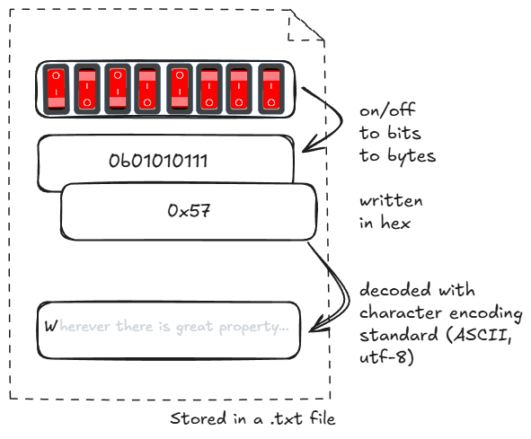
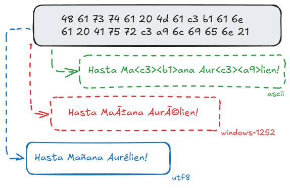

```{r set-options, echo=FALSE, cache=FALSE, warning=FALSE}
options(width = 100)
library(knitr)
library(tidyverse)
knitr::opts_chunk$set(class.source = "chunkstyle")
```


# Recap

## Goals of last lecture

  1. Get the basics of **data processing**
  2. Learn what **binary** and **hexadecimal** systems are
  3. See why **encoding** is crucial for any data project
  4. Realize that both code and data are just **text** at their core
  5. Know the basic components of a **computing environment** (self-study 🔎)

```{r  echo=FALSE, eval=FALSE}
x <- "Hasta Mañana Aurélien!"

charToRaw(x)
#>  [1] 48 61 73 74 61 20 4d 61 c3 b1 61 6e 61 20 41 75 72 c3 a9 6c 69 65 6e 21

x # read as UTF-8
iconv(x, from = "UTF-8", to = "ASCII", sub = "byte")
# [1] "Hasta Ma<c3><b1>ana Aur<c3><a9>lien!"

iconv(x, from = "windows-1252", to = "UTF-8")
#C3 B1 (ñ)	C3 → Ã, B1 → ±	ñ
#C3 A9 (é)	C3 → Ã, A9 → ©	é

# Bytes in Windows-1252 (22 instead of 24)
iconv(x, from = "UTF-8", to = "windows-1252", toRaw = TRUE)[[1]]
#>  [1] 48 61 73 74 61 20 4d 61 f1 61 6e 61 20 41 75 72 e9 6c 69 65 6e 21

# Count characters vs bytes
nchar(x) # 22
nchar(x, type = "bytes") # 24

# Back from hex to text
rawToChar(as.raw(c(0x57))) # "W"

# Simulate the error: read UTF-8 bytes with the wrong table
iconv(x, from = "windows-1252", to = "UTF-8")
#> "Hasta Mañana Aurélien!"
```


## From binary to `.txt`

:::: {.columns style="display: flex; align-items: center;"}

::: {.column style="width: 70%; text-align: center;"}
{width="120%"}
:::

::: {.column .fragment style="width: 30%; font-size: 0.75em;"}
#### Binary:

- Base 2. Only two signs: `0`, `1`.
- Columns: $2^0=1$, $2^1=2$, $2^2=4$, and so forth.
- Floating point numbers


#### Hexadecimal:

  - 16 symbols
  - Base 16.
  - `0`-`9` (used like in the decimal system) and `A`-`F` (for the numbers 10 to 15).
:::

::::


## Character encodings

- *Standards* define how `0`s and `1`s correspond to specific characters of different human languages.
- Coded character sets that map unique numbers (in the end in binary coded values) to each character in the set.
- For example, ASCII (American Standard Code for Information Interchange) or *utf-8*.

```{r ascii, echo=FALSE, out.width = "30%", fig.align='center', fig.cap='ASCII logo. (public domain).', purl=FALSE}
include_graphics("../../img/ascii.gif")
```


## Character encodings

```{r echo=FALSE, out.width = "80%", fig.align='center', purl=FALSE}

```

  - **Recognize an encoding issue when it occurs!**
  - Problem occurs right at the beginning of the *data pipeline*!

<!--
NOTES: same bytes, three readings

| Bytes | UTF-8 | ASCII                           | Windows-1252                  |
|-------|-------|---------------------------------|-------------------------------|
| C3 B1 | ñ     | not defined, shown as <c3><b1>  | ñ (C3 = Ã, B1 = ±)           |
| C3 A9 | é     | not defined, shown as <c3><a9>  | é (C3 = Ã, A9 = ©)           |

ASCII: these bytes have no meaning. ASCII only goes up to 7F (127); C3, B1, A9 are above.
  R cannot decode them and prints the raw bytes in angle brackets: <c3><b1>, <c3><a9>.

Windows-1252: every byte from 80 to FF is a character, so each byte is decoded on its own
  (one character per byte). That is why one wrong letter becomes two (ñ, é).

Full phrase:
  UTF-8         Hasta Mañana Aurélien!
  ASCII         Hasta Ma<c3><b1>ana Aur<c3><a9>lien!
  Windows-1252  Hasta Mañana Aurélien!

-->


## Components of a standard computing environment

```{r components, echo=FALSE, out.width = "80%", fig.align='center', purl=FALSE}
include_graphics("../../img/script-hardware.jpg")
```

Reading: please read the document "Data Processing Basics". This is exam relevant! 🔎


## Exercise: a website scraper{.smaller}

Last time, we saw that a webpage is nothing but **text** (HTML). We looked at its hexadecimal representation. The size in RAM of our "economist" html object was `468048 bytes`.

<br>


:::: {.columns}

::: {.column width="40%"}
#### From hexadecimal

```{r, echo=TRUE, eval = FALSE}
library(httr)
economist <- GET("https://www.economist.com/")
head(content(economist, as = "raw"), 20)
```
```{}
 [1] 3c 21 44 4f 43 54 59 50 45 20 68 74 6d 6c 3e 3c 68 74 6d 6c
```
:::

::: {.column width="30%"}
#### ... to html...

```{r, echo = TRUE, eval = FALSE}
head(content(economist, as = "text"))
```

```{}
"<!DOCTYPE html><html lang=\"en\"><head>
```

:::

::: {.column width="30%"}
#### ... to website
```{r snap, echo=FALSE, out.width = "100%"}
include_graphics("../../img/economist_example.png")
```
:::

::::


# Warm-up

## Warm-up 1&2

#### What is 234 in binary? Please answer exact response with format 00000000.

```{r, echo=FALSE, eval = FALSE}

decimal_to_binary_integers <- function(decimal) {

  bin <- c()

  while(decimal > 0){
    q <- decimal %% 2
    decimal <- decimal %/% 2
    bin <- c(q, bin)
  }

  bin <- paste0(bin, collapse = "")
  return(bin)
}

decimal_to_binary_integers(234)
```


<br>

#### What is 22C (hex) in decimal?
```{r, echo = FALSE, eval = FALSE}
556
```


## Warm-up 3

Consider the following `R` function:

```{r, echo=TRUE, eval = FALSE}
muLtip <- function(n, limit) {

  product <- 1
  counter <- 1

  while (counter <= n) {
    product <- product * counter
    if (product > limit) {
      return(product)
    }
    counter <- counter + 1
  }
  return(product)
}
```


What is `muLtip(5,20)`?


## Warm-up 4: question from lecture 3

#### Advantages (when working with binary numbers)

1. Shorter than raw binary representation
2. Much easier to translate back and forth between binary and hexadecimal than binary and decimal.

&nbsp;

<center>
*WHY?*

😆
</center>


## Warm-up 4: Why?

##### One hex digit = exactly 4 bits, because $2^4 = 16$

Translating between binary and hexadecimal is straightforward: each hexadecimal digit maps directly to a group of **4 binary digits**

::: {style="font-size: 0.7em;"}
| Decimal | Binary | Hex |
|--------:|:------:|:---:|
| 0  | 0000 | 0 |
| 1  | 0001 | 1 |
| …  | …    | … |
| 9  | 1001 | 9 |
| 10 | 1010 | A |
| …  | …    | … |
| 15 | 1111 | F |
:::

#### Example: the letter W

`0101 0111` → `5` `7` → `0x57`, just regroup


# Course organization

## Group formation for the group project

#### Timeline:

- **09.10.2026**: group formation opens on **Canvas**
- **16.10.2026**: deadline for group formation

#### Important:

- Groups of 5️⃣ students, compulsory for the group project.
- No group (or an incomplete group) by 16.10? We will assign you to one.

##### Once formed, groups stay fixed for the whole project.


# Today

## Our story today: from text to data

:::: {.columns style="display: flex; align-items: flex-start;"}

::: {.column .fragment style="width: 85%; font-size: 0.75em;"}
```{r , echo=FALSE, out.width = "100%"}
include_graphics("../../img/l4_story.png")
```
:::

::: {.column .fragment style="width: 15%; font-size: 0.75em; align-self: center;"}
  - Text encodes meaning
  - Files encode structure (→ Structured Files (CSV))
  - R parses structure into memory. (→ R Parsing → R Data Structures)
:::

::::


## Goals for today

  - Understand how we **import** and structure data from text files
  - Learn **data structures** in R
  - Understand and manipulate **rectangular data formats**


# From text to data structure

## Structured Data Formats

We are used to not thinking about the formats of our data... and let the computer choose what to do with data when we click on a file.

<br>

##### [All data are text files]{.green-bold}, but with standardized structure.

  - Text represents structured data
  - **Special characters** define the structure.
  - More complex **syntax**, more complex structures can be represented...


## Data take different structures depending on their purpose

:::: {.columns}
::: {.column width="45%"}
```{r, echo=FALSE, out.width = "100%"}
include_graphics("../../img/rectangulardata.png")
```
:::

::: {.column width="55%"}
```{r, echo=FALSE, out.width = "100%"}
include_graphics("../../img/nonrectangulardata.png")
```
:::

::::

<!--
Nested / hierarchical	records contain lists or sub-records	JSON, XML	API responses (World Bank, SNB, Twitter/X)
Varying length	each record has a different number of entries	JSON, lists	a firm with 1 or 30 subsidiaries; survey questions with multiple answers
Network / graph	the information is in the connections	edge lists, graph formats	trade flows between countries, board interlocks, co-authorship
Unstructured	no predefined fields at all	text, HTML, images, audio	central bank speeches, news, earnings calls, satellite images
-->


## Rectangular data

- **Rectangular data** refers to a data structure where information is organized into **rows and columns**.
  - Each row represents an observation or instance of the data.
  - Each column represents a variable or feature of the data.


## Rectangular data

- **Rectangular data** refers to a data structure where information is organized into **rows and columns**.
  - CSV (typical for rectangular/table-like data) and variants of CSV (tab-delimited, fix length etc.)
  - Excel spreadsheets (`.xlsx`)
  - Formats specific to statistical software (SPSS: `.sav`, STATA: `.dta`, etc.)
  - Built-in R datasets
  - ...


## Non-rectangular data

- **Hierarchical data** (xml, html, json, etc.)
  - XML and JSON (useful for complex/high-dimensional data sets)
  - HTML (a markup language to define the structure and layout of webpages)
- **Network data**
- Unstructured **text** data
- **Internet-of-Things** data
- **Images/Pictures** data


# Rectangular data formats

## Table-like formats

Example: `ch_gdp.csv`.

```{.txt }
year,gdp_chf
1980,184
1985,244
1990,331
1995,374
2000,422
2005,464
```

<br>

<center>
#### What is the structure?
</center>


## Table-like formats

- Reocurring pattern:
  - Special character `,`
  - New lines
  - Table is visible from structure in raw text file...

<br>

<center>
#### How can we instruct a computer to read this text as a 6-by-2 table?
</center>


## Using a simple parser algorithm

##### A **parser** is a sequence of rules of how to distinguish columns and rows when all that a computer can do is sequentially read one character after the other.

- Possible if we can agree on certain **standards/convention** of how data structured as a table/matrix is stored in a text file. []{style="display: block; height: 0.85em;"}


##### The CSV standard ('Comma-Separated Values', `.csv`)

  - Commas separate values (other delimiters  like `;`, tabs, etc. possible)
  - New lines separate rows/observations


## Using a simple CSV parser


#### Look for...

  - Commas delimit values/fields in a row
  - Line breaks indicate the end of a row

  []{style="display: block; height: 0.85em;"}

:::: {.columns}
::: {.column width="35%"}

```{.txt }
year,gdp_chf
1980,184
1985,244
1990,331
1995,374
2000,422
2005,464
```
:::
::: {.column width="65%"}

```{.txt}
ef bb bf 79 65 61 72 2c 67 64 70 5f 63 68 66 0a
31 39 38 30 2c 31 38 34 0a
31 39 38 35 2c 32 34 34 0a
31 39 39 30 2c 33 33 31 0a
31 39 39 35 2c 33 37 34 0a
32 30 30 30 2c 34 32 32 0a
32 30 30 35 2c 34 36 34
```
:::
::::

<!--
```{}
00000000: efbb bf79 6561 722c 6764 705f 6368 660a  ...year,gdp_chf.
00000010: 3139 3830 2c31 3834 0a31 3938 352c 3234  1980,184.1985,24
00000020: 340a 3139 3930 2c33 3331 0a31 3939 352c  4.1990,331.1995,
00000030: 3337 340a 3230 3030 2c34 3232 0a32 3030  374.2000,422.200
00000040: 352c 3436 34                             5,464
```
-->


```{r eval = FALSE}
readBin("data/ch_gdp.csv", "raw", n = 100)
```

<!--
NOTES: how to read the hex dump of ch_gdp.csv

Left column (00000000:, 00000010:, ...) = offset: position of the row's first byte,
  counted in HEX from 0. 00000010 = byte 16, 00000020 = byte 32. 16 bytes per row.

ef bb bf = BOM (byte order mark): invisible signature "this file is UTF-8".
  Invented for UTF-16 (byte order); UTF-8 does not need it, but Excel "CSV UTF-8" writes it.

2c = comma (column separator)

0a = line feed (LF, \n), end of row. Line endings depend on the program that SAVED the file:
  LF    0a     Mac, Linux, R, most modern tools
  CRLF  0d 0a  Windows programs (Notepad, Excel on Windows)
  CR    0d     classic Mac OS (before 2001); the original ch_gdp.csv had this (converted to LF, Oct 2026)
  read_csv() accepts all three.
  -> issue in git: .gitattributes (data/*.csv -text) stops Git from turning 0a into 0d 0a on Windows.

Right column = bytes shown as text; every non-printable byte is shown as "."
  "..."       = ef bb bf (the BOM)
  "chf.1980"  = chf + 0a (line break) + 1980

-->


## CSVs and fixed-width format

  - Common format to store and transfer data.
  - Very common in a data analysis context.
  - Natural format/structure when the dataset can be thought of as a table.


<br>

<center>
#### How can `R` read this structure?
</center>


# Importing Rectangular Data from Text-Files

<!-- ===== NEW PROPOSAL (4 slides, stock_prices.csv). Old slides follow below, unchanged. ===== -->

## From text to table

:::: {.columns}

::: {.column width="45%"}
#### The file `stock_prices.csv`

(not real market data 💸)

```{}
date,time,ticker,company,close_chf,volume,dividend_paid
2026-10-01,17:30,NESN,Nestlé,78.42,4210350,FALSE
2026-10-01,17:30,UBSG,UBS,27.15,9876012,FALSE
2026-10-01,17:30,NOVN,Novartis,96.80,3120457,TRUE
2026-10-02,17:30,NESN,Nestlé,78.90,3988120,FALSE
2026-10-02,17:30,UBSG,UBS,27.40,10233990,FALSE
2026-10-02,17:30,NOVN,Novartis,95.95,2874001,FALSE
```
:::

::: {.column .fragment width="55%"}
#### After being parsed in `R`

```{r, eval=FALSE, echo=TRUE}
library(readr)
stocks <- read_csv("data/stock_prices.csv")
stocks
```

```{r, echo=FALSE, message=FALSE, purl=FALSE}
library(readr)
stocks <- read_csv("../../data/stock_prices.csv")
stocks
```
:::

::::


## Parsing CSVs in R with `readr`

:::: {.columns}

::: {.column width="80%"}
Use `read_csv()` from the `readr` package instead of `read.csv()` from the basic R distribution

  - `readr` offers functions for all common rectangular data formats (`read_tsv()` for tab-separated, `read_fwf()` for fixed-width, etc.)
  - More robust and faster than similar functions in basic R.
  - The result is a `data frame` (or `tibble`)
:::

::: {.column width="20%"}
{width="100%"}
:::

::::

::: {.Example .absolute bottom=20 style="font-size: 0.8em;"}
- For very large files, the `data.table`-package and the `fread()` is much faster and guesses the delimiter itself.
- `readr` documentation and cheatsheet: [readr.tidyverse.org](https://readr.tidyverse.org/)
:::


## Parsing CSVs

Recognizing columns and rows is one thing...

```{r}
stocks
```

<br>

<center>
#### What else did `read_csv()` recognize?
</center>


## What else did `read_csv()` recognise?

##### The parser guesses the data type of each column from its content.

```{r, echo=TRUE, message=FALSE}
library(dplyr)
glimpse(stocks)
```


## Parsing CSV-columns

::: {.incremental}
  - `"12:00"`: type `character`?
  - What about `c("12:00", "midnight", "noon")`?
  - And now `c("12:00", "14:30", "20:01")`?
:::


## Parsing CSV-columns

#### ... Let's test it!

```{r, echo = TRUE}
read_csv('A,B
         12:00, 12:00
         14:30, midnight
         20:01, noon')
```

<center>
#### How can `read_csv()` distinguish the two cases?
</center>


## Parsing CSV-columns: guess types

  - `read_csv()` guesses the column type by inspecting the first 1000 rows and matching patterns: numeric, date/time, logical, character, etc.
  - Under the hood `read_csv()` used the `guess_parser()`- function to determine which type the two vectors likely contain:

```{r, echo = TRUE}
guess_parser(c("12:00", "midnight", "noon"))
guess_parser(c("12:00", "14:30", "20:01"))

parse_time(c("12:00", "14:30", "20:01"))
```


## Parsing CSV-columns: guess types

  - `read_csv()` guesses the column type by inspecting the first 1000 rows and matching patterns: numeric, date/time, logical, character, etc.
  - Under the hood `read_csv()` used the `guess_parser()`- function to determine which type the two vectors likely contain:

```{r, echo = TRUE, eval = TRUE}
guess_parser("1'300'000")
guess_parser("1'300'000", locale = locale(grouping_mark = "'"))
```
::: aside
Check this page from ["Data cleaning for data scientists"](https://bookdown.org/f_lennert/data-prep_2days/readr.html#rds-and-.rdatafiles) for more examples on `guess_parser()`.
:::


# R data structures in depth

## What is the representation of the structure once the data is parsed?

Once parsed, the data lives in RAM as R objects. The **atomic vectors** ⚛️ are the building blocks (see lecture 2).

:::: {.columns}

::: {.column width="55%"}
#### 1. Data types (what is stored)

| Type | Also called |
|------|-------------|
| `integer`   |  |
| `double`    | numeric, floating point |
| `character` | string, text |
| `logical`   | boolean |
:::

::: {.column .fragment width="45%"}

#### 2. Data structures in RAM

  - **Vectors**
  - **Arrays/Matrices**
  - **Lists**
  - **Data frames**
:::

::::


## Structures to work with in R

  - A data structure in R is a way of **organizing data in memory**: it defines how elements are grouped, stored, and accessed.
  - R has a few core structures:

| Structure          | Key idea                            | Type     | Dim. |
|--------------------|-------------------------------------|----------|------|
| Vector             | Ordered collection of values        | Homog.   | 1D   |
| Matrix             | 2D rectangular collection           | Homog.   | 2D   |
| Array              | Generalization of a matrix          | Homog.   | nD   |
| List               | Elements can differ in type/size    | Heterog. | Flex |
| Data frame/Tibble  | List of equal-length vectors        | Heterog. | 2D   |


## Describe data through type and class

The type and the class of an object can be used to describe an object.

  - `typeof()`: **how the object is stored in memory** (`double`, `character`, `list`, ...)
  - `class()`: **how R treats the object**

```{r, echo=TRUE, collapse=TRUE}
typeof(c(1, 2, 3))
class(c(1, 2, 3))

typeof(data.frame(x = 1:3)) # "list"
class(data.frame(x = 1:3))  # "data.frame"
```


## Data types: a recap

:::: {.columns}

::: {.column width="50%"}
#### `double`
```{r, echo=TRUE, collapse=TRUE}
a <- 1.5
typeof(a); class(a)
```

#### `character`
```{r, echo=TRUE, collapse=TRUE, error=TRUE}
c <- "3"
a + c
```
:::

::: {.column width="50%"}
#### `integer`
```{r, echo=TRUE, collapse=TRUE}
b <- 3L
typeof(b); class(b)
```

#### `logical`
```{r, echo=TRUE, collapse=TRUE}
d <- TRUE
typeof(d); class(d)
```
:::

::::

::: aside
**Special values**: `NA` missing value (any type); `NaN` "not a number" (numeric); `Inf` infinity (numeric); `NULL` absence of an object.
:::


## Vectors are collections of value of same type


:::: {.columns}

::: {.column width="50%"}
```{r, echo = TRUE, collapse=TRUE}
persons <- c("Andy", "Brian", "Andy")
persons
```
:::

::: {.column width="50%"}
```{r, echo = TRUE, collapse=TRUE}
ages <- c(24, 50, 30)
ages
```
:::
::::


#### What happens when you create a vector out of `persons` and `ages`?
```{r, eval = FALSE, echo = TRUE}
c(persons, ages)
```

::: {.fragment}
💥

```{r, eval = TRUE, echo = FALSE}
c(persons, ages)
```
:::


## Coercion

##### Process of converting an object from one data type to another.

- **Implicit**: happens automatically when combining objects of different types R will implicitly coerce to the most flexible type.
  -  e.g. `c(TRUE, 2L, 3.5, "a")` becomes all `character`[]{style="display: block; height: 0.7em;"}
- **Explicit**: use specific functions to manually convert data types `as.numeric()`, `as.character()`, `as.logical()`, etc.


> Coercion hierarchy: \ Types from least to most flexible are: `logical` → `integer` → `double` → `character`.


## More on coercion 🔎

Why is it that `TRUE + TRUE` is `2`?

```{r, echo = TRUE, collapse=TRUE}
TRUE + TRUE
typeof(TRUE + TRUE)
```

When you use **operators**, R will also apply the coercion rule to unify the types of all elements involved in the operation.

:::: {.columns}
::: {.column width="50%"}

#### Useful for mundane operations 🐈
```{r, echo = TRUE, collapse=TRUE}
has_a_cat <- c(TRUE, FALSE, FALSE, FALSE)

sum(has_a_cat)
```
:::

::: {.column width="50%"}

#### ...or for more serious ones...
```{r, echo = TRUE, collapse=TRUE}
income <- seq(40000, 80000, by = 1000)

mean(income > 50000)
```
:::
::::

::: aside
Check the chapter on coercion in [R Programming: Zero to Pro](https://r02pro.github.io/) by Yang Feng for more examples.
:::


## Data structures: matrices

  - Matrices are **two-dimensional** collections of values of the same type
  - Like vectors, they are **homogeneous**
  - They are vectors that have a dimension attribute `dim`

```{r matrix, echo=FALSE, out.width = "30%", fig.align='center', purl=FALSE}
include_graphics("../../img/matrix.png")
```


## Data structures: matrices/arrays

Example:

```{r, echo = TRUE}
my_matrix <- matrix(
  c(1,2,3,4,5,6),
  nrow = 3,
  byrow = FALSE
)
my_matrix
dim(my_matrix)
```


## Data structures: arrays

Arrays are **higher-dimensional** collections of values of the same type

```{r array, echo=FALSE, out.width = "40%", fig.align='center', purl=FALSE}
include_graphics("../../img/array.jpg")
```


## Data structures: matrices/arrays

Example:

```{r, echo = TRUE}
my_array <- array(1:12, dim = c(2, 3, 2))
my_array
```

<!--
NOTES: when do we use arrays?
Arrays = regular grid of numbers in 3+ dimensions, all of the same type.
Rare in everyday data work (data frames cover most needs).

  - Images: height x width x colour (RGB), e.g. a photo is a 1080 x 1920 x 3 array
  - AI / deep learning: batch x height x width x channels ("tensors" in torch/keras are arrays)
  - Simulations: parameter x replication x statistic (Monte Carlo in econometrics)
  - Bayesian estimation: iterations x chains x parameters (posterior draws from Stan, as.array())
  - Climate / satellite data: latitude x longitude x time (rasters, netCDF; night lights as GDP proxy)
  - Input-output tables over time: sector x sector x year

Why not a data frame?
  - fast maths across a whole dimension, e.g. apply(x, c(1, 2), mean) = average over time per location
  - fixed structure: every cell exists, one type
  - for analysis/plotting, usually convert to a long data frame: as.data.frame.table()

array() always fills column-first (first index fastest), no byrow option.
Careful: array(c(1,...,8), dim = c(2,3,4)) has 24 cells for 8 values, so R silently recycles.
Better: array(1:12, dim = c(2, 3, 2)).

-->


## Data frames, tibbles, and data tables

  - Each column contains a vector of a given data type (or factor), but all columns need to be of identical length.
  - Under the hood, a data frame is a list of equal-length vectors.
  - `data.frame`, `tibble`, `data.table`


```{r df, echo=FALSE, out.width = "40%", fig.align='center',  purl=FALSE}
include_graphics("../../img/dataframe.jpg")
```


## Data frames, tibbles, and data tables

Example:

```{r, echo = TRUE}
df <- data.frame(person = persons, age = ages, gender = c(0,1,1))
df
```


## Data structures: lists

Lists can contain different data types in each element, or even different data structures of different dimensions.

```{r list, echo=FALSE, out.width = "40%", fig.align='center', purl=FALSE}
include_graphics("../../img/list.jpg")
```


## Data structures: lists

Example:

```{r, echo = TRUE}
my_list <- list(my_array, my_matrix, df)
my_list
```


## Data structures: lists

```{r, echo=FALSE, out.width = "40%", fig.align='center',  purl=FALSE}
include_graphics("../../img/meme_list.png")
```


## Data attributes

Most common attributes:

  - names and dimnames
  - dim
  - class
  - levels
  - length


## Data attributes

```{r, echo = TRUE}
x <- c(a=1, b=2, c=3)
names(x)

m <- matrix(1:6, nrow=2)
dim(m)
dimnames(m) <- list(c("row1", "row2"), c("col1", "col2", "col3"))
m
```


## Data structures: factors

- Factors are sets of categories.
- The values come from a fixed set of possible values.

```{r factor, echo=FALSE, out.width = "10%", fig.align='center',  purl=FALSE}
include_graphics("../../img/factor.png")
```


## Data structures: factors

Example:

```{r, echo = TRUE}
gender <- factor(c("Male", "Male", "Female"))
gender
```

Factors are "disguised" integers...

```{r, echo = TRUE}
typeof(gender)
```


## Data structures: factors

Two components:

  - the integer (or "levels");
  - the labels.

```{r, echo = TRUE}
levels(gender)
```


## Dates 🔎

:::: {.columns}

::: {.column width="50%"}
📆 Dates are "disguised" doubles... that counts the number of days since 01.01.1970

```{r, echo=TRUE, collapse=TRUE}
d <- as.Date(c("2026-10-01", "1936-10-08"))
typeof(d)
class(d)
as.numeric(d)
```
:::

::: {.column .fragment width="50%"}
You can compute with them:

```{r, echo=TRUE, collapse=TRUE}
d[2] - d[1]
d + 7
```

And indicate which format you are using:

```{r, echo=TRUE, collapse=TRUE}
as.Date("01.10.2026", format = "%d.%m.%Y")
```
:::

::::


## Dates and times 🔎

:::: {.columns}

::: {.column width="50%"}
⏲️ A date-time is a "disguised" double too: seconds since 1970-01-01, plus a time zone.

```{r, echo=TRUE, collapse=TRUE}
x <- as.POSIXct("2026-10-01 17:30",
                tz = "Europe/Zurich")
typeof(x)
class(x)
as.numeric(x)
```
:::

::: {.column .fragment width="50%"}
For any date-time format, I recommend `lubridate`!

```{r, echo=TRUE, collapse=TRUE, message=FALSE}
library(lubridate)
dmy_hm("01.10.2026 17:30", tz = "Europe/Zurich")
```
:::

::::

> **Note:** Always set the time zone (`tz`). Without it, R uses your computer's time zone, and the same file can give different times on different laptops.


## Different data types in one figure

```{r summary, echo=FALSE, out.width = "40%", fig.align='center', purl=FALSE, fig.cap = "Source: http://venus.ifca.unican.es/Rintro/dataStruct.html"}
include_graphics("../../img/data_structure_r.png")
```


# Manipulating rectangular data in R

## Loading built-in datasets

Load the built-in `swiss` dataset using the `data()`-function.

```{r, eval=TRUE, echo = TRUE}
data(swiss)
```

::: aside
Famous built-in datasets are `mtcars`, `iris`, `USArrests`, etc. The `swiss` dataset is loaded from the package `datasets`, which can be installed with the command `install.packages("datasets")`. Description of the dataset is [here](https://stat.ethz.ch/R-manual/R-devel/library/datasets/html/swiss.html).
:::


## Manipulations with data frames

```{r, echo = FALSE}
swiss <- as.data.frame(swiss)
```


```{r, eval=TRUE, echo = TRUE}
# inspect the structure
str(swiss)

# look at the first few rows
head(swiss, n = 5)
```


## Work with data.frames

#### Select columns

```{r, eval = FALSE, echo = TRUE}
swiss$Fertility # use the $-operator
```

```{r, eval = FALSE, echo = TRUE}
swiss[, 1] # use brackets [] and the column number/index
```

```{r, eval = FALSE, echo = TRUE}
swiss[, "Fertility"] # use the name of the column
```

```{r, eval = FALSE, echo = TRUE}
swiss[, c("Fertility", "Agriculture")] # use the name of the column
```
<br>

#### Select rows
```{r, eval = FALSE, echo = TRUE}
swiss[1,]  # First row
```

```{r, eval = FALSE, echo = TRUE}
swiss[swiss$Fertility > 40,]  # Based on condition ("filter")
```


# Other Common Rectangular Formats 🔎

## Spreadsheets/Excel

:::: {.columns}

::: {.column width="80%"}

Needs the additional R-package: `readxl`. Then we use the package's `read_excel()`-function to import data from an excel-sheet.

:::

::: {.column width="20%"}


```{r readxl, echo=FALSE, out.width = "40%", fig.align='center', purl=FALSE}
include_graphics("../../img/readxl.png")
```

:::
::::

```{r, eval=FALSE, echo = FALSE}
# load the package
library(readxl)

# import data from a spreadsheet
swiss_imported <- read_excel("../../data/swiss.xlsx")
```


```{r, eval=FALSE, warning=FALSE, echo = TRUE}
# install the package
install.packages("readxl")

# load the package
library(readxl)

# import data from a spreadsheet
swiss_imported <- read_excel("data/swiss.xlsx")
```


## Write an Excel Spreadsheet

:::: {.columns}
::: {.column width="80%"}
<br>

- Use [`openxlsx`](https://ycphs.github.io/openxlsx/) to write, style, and edit .xlsx files.
- Alternative to the xlsx package with no dependency on Java.

:::

::: {.column width="20%"}

```{r openxlsx, echo=FALSE, out.width = "70%", fig.align='center', purl=FALSE}
include_graphics("../../img/openxlsx.png")
```

:::
::::


## Data from other data analysis software

#### STATA, SPSS, etc.

- Additional packages needed: `foreign`, `haven`, etc.

- Parsers (functions) for many foreign formats.
    - For example, `read_spss()` for SPSS' `.sav`-format.


```{r, echo=FALSE, purl=FALSE, warning=FALSE}
# install the package (if not yet installed):
# install.packages("haven")

# load the package
library(haven)

# read the data
swiss_imported <- read_spss("../../data/swiss.sav")

```

```{r, eval=FALSE, echo=TRUE}
# Load library
library(haven)

# Read file from SPSS
swiss_imported <- read_spss("data/swiss.sav")
```


# Exercise 🔎


## Exercise

- Download the `financial_data.txt` from Canvas


# Appendix: a side note on data frames and tibbles


## Rectangular data in R and tidyverse

- data frames: base `R`
- tibbles: `tidyverse`


## Tibbles are a modern version of data frames

Similar!

- Tibbles are used in the `tidyverse` and `ggplot2` packages.
- Same information as a data frame.
- Small differences in the manipulation and representation of data.
- See [**Tibble vs. DataFrame**](https://jtr13.github.io/cc21fall1/tibble-vs.-dataframe.html#tibble-vs.-dataframe") for more details.


## Tibbles are a modern version of data frames

```{r, eval=TRUE, message=FALSE, warning=FALSE}
library(tidyverse)

as_tibble(swiss)
```


## Tibbles are a modern version of data frames

```{r, eval=TRUE, message=FALSE, warning=FALSE}
library(tidyverse)

as.data.frame(swiss)
```


## Tibbles vs data frames

- Unlike data frames, tibbles don’t show the entire dataset when you print it
- Tibbles cannot access a column when you provide a partial name of the column, but data frames can.
- When you access only one column of a tibble, it will keep the tibble structure. But when you access one column of a data frame, it will become a vector.
- When assigning a new column to a tibble, the input will not be recycled, which means you have to provide an input of the same length of the other columns. But a data frame will recycle the input.
- Tibbles preserve all the variable types, while data frames have the option to convert string into factor. (In older versions of R, data frames will convert string into factor by default)

::: aside
Source: https://jtr13.github.io/cc21fall1/tibble-vs.-dataframe.html
:::

