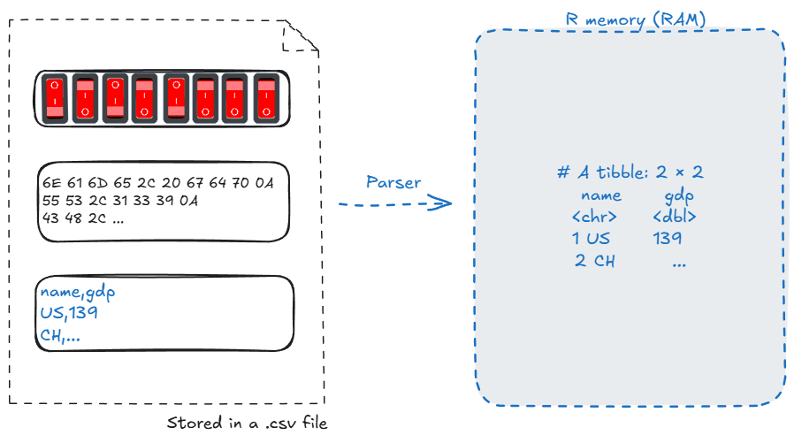
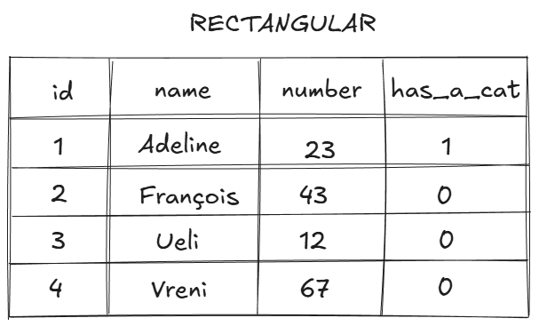
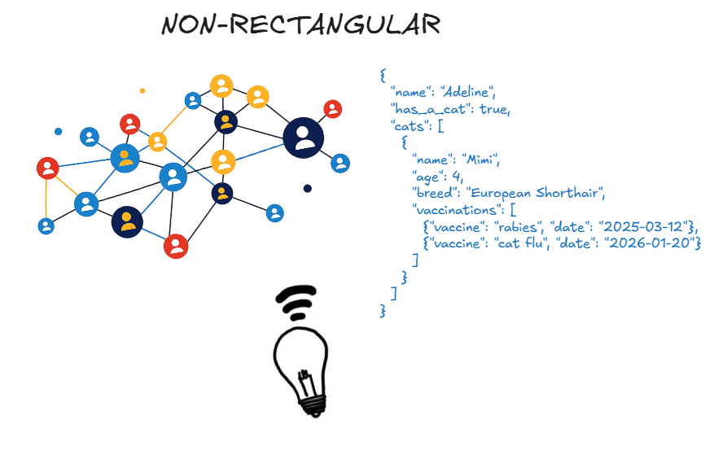
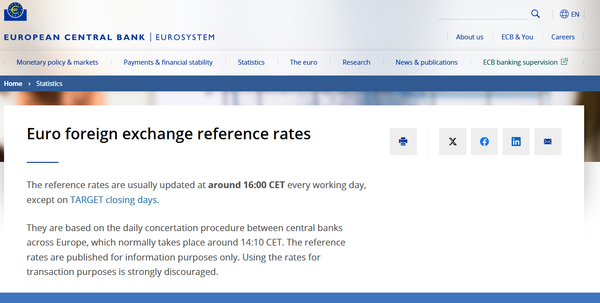

```{r set-options, echo=FALSE, message=FALSE, warning=FALSE, cache=FALSE}
options(width = 100)
library(knitr)
library(dplyr)
library(readr)
```


# Recap


## Last time: from text to data

:::: {.columns style="display: flex; align-items: flex-start;"}

::: {.column .fragment style="width: 70%; font-size: 0.75em;"}
```{r , echo=FALSE, out.width = "100%"}

```
:::

::: {.column .fragment style="width: 30%; font-size: 0.85em; align-self: center;"}
#### Goals:

  - Understand how we **import** and structure data from text files
  - Learn **data structures** in R
  - Understand **rectangular data formats**

:::

::::


## Data take different structures depending on their purpose

:::: {.columns}
::: {.column width="45%"}
```{r, echo=FALSE, out.width = "100%"}

```
:::

::: {.column width="55%"}
```{r, echo=FALSE, out.width = "100%"}

```
:::

::::


## Using a simple parser algorithm {visibility="hidden"}

[Parser]{.green-bold}: sequence of instructions/rules of how to distinguish columns and rows when all that a computer can do is sequentially read one character after the other.

A [csv-parser]{.green-bold} takes a text file with CSV standard structure as input and builds a data structure in the form of a table.

:::: {.columns}
::: {.column width="35%"}

```{.txt }
year,gdp_chf
1980,184
1985,244
1990,331
1995,374
2000,422
2005,464
```
:::
::: {.column width="65%"}

```{.txt}
ef bb bf 79 65 61 72 2c 67 64 70 5f 63 68 66 0a
31 39 38 30 2c 31 38 34 0a
31 39 38 35 2c 32 34 34 0a
31 39 39 30 2c 33 33 31 0a
31 39 39 35 2c 33 37 34 0a
32 30 30 30 2c 34 32 32 0a
32 30 30 35 2c 34 36 34
```
:::
::::


## Parsing CSVs in `R` using `read_csv()` {visibility="hidden"}

- From the `readr` library, use `read_csv()`, `read_delim()` to parse CSVs
- To parse, encode, and guess the right type: `guess_parser()`
```{r, echo = TRUE}
read_csv('A,B
         12:00, 12:00
         14:30, midnight
         20:01, noon')
```


## Different data types in one figure

```{r summary, echo=FALSE, out.width = "40%", fig.align='center', purl=FALSE, fig.cap = "Source: http://venus.ifca.unican.es/Rintro/dataStruct.html"}
include_graphics("../../img/data_structure_r.png")
```


## Important concepts {visibility="hidden"}

#### Implicit coercion
```{r, echo = TRUE, collapse=TRUE}
matrix(c(1, 2, 3, "Frodo", "Gandalf", "Sam"), ncol = 2)
```

#### Homogenous and heterogenous types
```{r, echo = TRUE, collapse=TRUE}
data.frame("ID" = c(1, 2, 3), "NAME" = c("Frodo", "Gandalf", "Sam"))
```


## Important concepts {visibility="hidden"}

#### Factors are "disguised integers"

Factors are used to work with **categorical variables**, variables that have a fixed and known set of possible values.

```{r, echo = TRUE, collapse=TRUE}
middle_earth <- factor(c("Hobbit", "Dwarf", "Elf", "Dwarf", "Elf", "Hobbit"),
                       levels = c("Hobbit", "Dwarf", "Elf"))

middle_earth <- factor(c(1,2,3,2,3,1),
                       labels = c("Hobbit", "Dwarf", "Elf"))

sort(middle_earth)
levels(middle_earth)
typeof(middle_earth)
```


## Work with data frames

#### Load built-in dataset `swiss`

`swiss` ships with R in the `datasets` package: *Swiss Fertility and Socioeconomic Indicators (1888)*. It has 47 French-speaking Swiss districts and 6 variables:

```{r, eval = TRUE, echo = TRUE}
data(swiss)

head(swiss)
```

> Check `data()` to find out about all built-in datasets in `R`.


## Work with data.frames

#### Select columns

```{r, eval = FALSE, echo = TRUE}
swiss$Fertility # use the $-operator
swiss[, 1] # use brackets [] and the column number/index
swiss[, "Fertility"] # use the name of the column
swiss[, c("Fertility", "Agriculture")] # use the name of the column
```

#### Select rows
```{r, eval = FALSE, echo = TRUE}
swiss[1,]  # First row
swiss[swiss$Fertility > 40,]  # Based on condition ("filter")
```

#### Create columns
```{r, eval = FALSE, echo = TRUE}
swiss$Protestant <- 100 - swiss$Catholic
```


## Three lessons from the financial data exercise

#### 1. Check the delimiter first. Look at the raw file: here `:`, not `,`

  - `read.csv(sep = ":")` or `read_delim(delim = ":")`

#### 2. Find the right encoding. `<f6>` is `ö` in Latin-1 ("ISO-8859-1")

  - `read.csv(fileEncoding = "ISO-8859-1")`.

#### 3. One bad value changes the type of the whole column.

  - A column has only one type: `"1933ö"` turned `Revenue` into `character`


# Warm-up

## Factors

The following code produces  `"apple", "banana", "apple", "cherry"`

True or false?

```{r echo = TRUE, eval = FALSE}
fruits <- factor(c("apple", "banana", "apple", "cherry"))
levels(fruits)
```


## Coercion of boolean values

This question checks your understanding of the coercion of boolean values.

What is the output of the following code?
```{r echo = TRUE, eval = FALSE}
my_vector <- c(1, 0, 3, -1)
as.numeric(my_vector > 0)
```

- `"TRUE" "FALSE" "TRUE" "FALSE"`
- `TRUE FALSE TRUE FALSE`
- `1 0 1 0`
- `0 1 0 1`


## Data frames operations

Consider the data frame

```{r echo = TRUE}
df <- data.frame(
  "City" = c("St.Gallen", "Lausanne", "Zürich"),
  "PartyLeft" = c(35, 45, 55),
  "PartyRight" = c(40, 35, 30)
)
```

Which of these statements are TRUE?

::: {style="font-size: 0.8em;"}
- `df$PartyCenter <- c(25, 20, 15)` creates a new variable called "PartyCenter"
- 🌶️🌶️`dim(df[, df$PartyLeft > 40])` returns the same as `dim(df[, c(2,3)])`
- `dim(df[df$PartyLeft > 40 | df$PartyLeft < 40, ])` returns `c(3,3)`
- `df` is a data.frame, which is a list consisting of one named character vector and two named numeric vectors.
:::

<!-- The second question is about recycling of logical vectors... -->
<!-- ```{r echo = TRUE} -->
<!-- df <- data.frame( -->
<!--   "City" = c("St.Gallen", "Lausanne", "Zürich"), -->
<!--   "PartyLeft" = c(35, 45, 55), -->
<!--   "PartyRight" = c(40, 35, 30), -->
<!--   "PartyCenter" = c(25, 20, 15) -->
<!-- ) -->

<!-- dim(df[, df$PartyLeft < 40]) -->
<!-- dim(df[, df$PartyLeft == 45, drop = F]) -->
<!-- dim(df[, c(2,3)]) -->

<!-- #If the index vector is shorter than the vector being indexed, the index vector is recycled -->
<!-- x <- c(5,4,7,8) -->

<!-- x[c(FALSE, TRUE)] -->
<!-- #> [1] 4 8 -->
<!-- ``` -->


## Data frames {visibility="hidden"}

Consider the following code

```{r, echo = TRUE}
df <- data.frame(a = c(1,2,3,4),
                 b = c("au", "de", "ch", "li"))
```

Are these statements TRUE or FALSE?

- `mean(df$a) == 2.5`
- `typeof(as.matrix(df)[,1])` is `numeric` (or `double`)


# Updates


## Next week

<br>

  - ["Leverage APIs for Economic Data"]{.green-bold} with Minna Heim
  - ⚡provides with the basis knowledge to solve the first part of the group project


# Today


## Goals of today's lecture

- Understand **non-rectangular data**: xml, json, and html
- Be familiar with the way we **parse** these data into R
- **Scrape a webpage** following its html structure


# Non-rectangular data structures

## Non-rectangular data

:::: {.columns}

::: {.column width="50%"}

[]{style="display: block; height: 0.5em;"}

- Hierarchical data (xml, html, json)
  - <span style="color: gray">XML and JSON (useful for complex/high-dimensional data sets)</span>.
  - <span style="color: gray">HTML (a markup language to define the structure and layout of webpages)</span>.
- Unstructured text data
- Images/Pictures data
:::

::: {.column width="50%"}
{width="100%"}
:::

::::


## A rectangular data set

```{.txt}
father mother  name     age  gender
               John      33  male
               Julia     32  female
John   Julia   Jack       6  male
John   Julia   Jill       4  female
John   Julia   John jnr   2  male
               David     45  male
               Debbie    42  female
David  Debbie  Donald    16  male
David  Debbie  Dianne    12  female

```

<br>

<center>
### 👓 What is the data about?
</center>


## A rectangular data set

```{.txt}
father mother  name     age  gender
               John      33  male
               Julia     32  female
John   Julia   Jack       6  male
John   Julia   Jill       4  female
John   Julia   John jnr   2  male
               David     45  male
               Debbie    42  female
David  Debbie  Donald    16  male
David  Debbie  Dianne    12  female

```
<br>

<center>
### Which observations belong together?
</center>


## A rectangular data set

```{.txt}
father mother  name     age  gender
               John      33  male
               Julia     32  female
John   Julia   Jack       6  male
John   Julia   Jill       4  female
John   Julia   John jnr   2  male
               David     45  male
               Debbie    42  female
David  Debbie  Donald    16  male
David  Debbie  Dianne    12  female

```
<br>

<center>
### Can a parser understand which observations belong together?
</center>


<!-- As we observed in the previous chapter, the CSV structure has some disadvantages when representing more complex data in a text file. This is in particular true if the data contains nested observations (i.e., hierarchical structures). While a representation in a CSV file is theoretically possible, it is often far from practical to use other formats for such data. On the one hand, it is likely less intuitive to read the data correctly. On the other hand, storing the data in a CSV file might introduce a lot of redundancy. That is, the identical values of some variables would have to be repeated in the same column. The following code block illustrates this point for a data set on two families ([@murrell_2009], p. 116). -->

<!-- From simply looking at the data, we can make the best guess which observations belong together (are one family). However, the implied hierarchy is not apparent at first sight. While it might not matter too much that several values have to be repeated several times in this format, given that this data set is so small, the repeated values can become a problem when the data set is much larger. For each time `John` is repeated in the `father`column, we use 4 bytes of memory. Suppose millions of people are in this data set, and we have to transfer this data set very often over a computer network. In that case, these repetitions can become quite costly (as we would need more storage capacity and network resources). -->


# Deciphering XML


## XML - eXtensible Markup Language

- A markup language and file format for **storing**, **transmitting**, and **reconstructing** data
- Defines a set of rules for encoding documents in a format that is both **human-readable** and **machine-readable**
- Appeared in 1998

#### Real life examples:

  - Microsoft Office uses the XML-based file formats, such as `.docx`, `.xlsx`, and `.pptx`.
  - SWIFT (cross-border payments) uses ISO 20022 XML
  - Official statistics and Central banks
  - Store geospatial data in Geographic Information Systems (GIS)


<!-- What is XML? Good intro in https://www.sitepoint.com/really-good-introduction-xml/#h-what-is-xml
The essence of XML is in its name: Extensible Markup Language.

Extensible: XML is extensible. It lets you define your own tags, the order in which they occur, and how they should be processed or displayed. Another way to think about extensibility is to consider that XML allows all of us to extend our notion of what a document is: it can be a file that lives on a file server, or it can be a transient piece of data that flows between two computer systems (as in the case of Web Services).

Markup: The most recognizable feature of XML is its tags, or elements (to be more accurate). In fact, the elements you’ll create in XML will be very similar to the elements you’ve already been creating in your HTML documents. However, XML allows you to define your own set of tags.

Language: XML is a language that’s very similar to HTML. It’s much more flexible than HTML because it allows you to create your own custom tags. However, it’s important to realize that XML is not just a language. XML is a meta-language: a language that allows us to create or define other languages. For example, with XML we can create other languages, such as RSS, MathML (a mathematical markup language), and even tools like XSLT. More on this later.-->


## Meteo data in XML format

<center>
#### What features does the format have? What is its logic/syntax?
</center>


```{xml, echo = TRUE}
<?xml version="1.0" encoding="UTF-8"?>
<data>
  <row>
    <unique_id>216498</unique_id>
    <indicator_id>386</indicator_id>
    <name>Ozone (O3)</name>
    <measure>Mean</measure>
    <measure_info>ppb</measure_info>
    <geo_type_name>CD</geo_type_name>
    <geo_join_id>313</geo_join_id>
    <geo_place_name>Coney Island (CD13)</geo_place_name>
    <time_period>Summer 2013</time_period>
    <start_date>2013-06-01T00:00:00</start_date>
    <data_value>34.64</data_value>
  </row>

  <row>
    <unique_id>216499</unique_id>
    <indicator_id>386</indicator_id>
    ...
  </row>
</data>
```


## Meteo data in XML format

<center>
#### What features does the format have? What is its logic/syntax?
</center>


```{xml, echo = TRUE}
<?xml version="1.0" encoding="UTF-8"?>
<data>
  <row>
    <unique_id>216498</unique_id>
    <indicator_id>386</indicator_id>
    <name>Ozone (O3)</name>
    <measure>Mean</measure>
    <measure_info>ppb</measure_info>
    <geo_type_name>CD</geo_type_name>
    <geo_join_id>313</geo_join_id>
    <geo_place_name>Coney Island (CD13)</geo_place_name>
    <time_period>Summer 2013</time_period>
    <start_date>2013-06-01T00:00:00</start_date>
    <data_value>34.64</data_value>
  </row>

  <row>
    <unique_id>216499</unique_id>
    <indicator_id>386</indicator_id>
    ...
  </row>
</data>
```

::: {.content-hidden style="font-size: 0.8em;"}
  - A predefined set of **special characters** (here primarily `<`, `>`, and `/` ) give the data structure.
  - So-called **XML-tags** are used to define variable names and encapsulate data values: `<variablename>value</variablename>`.
  - Tags can be nested, which allows for the definition of hierarchical structures.
:::


## XML declaration

  - An XML document begins with some information about XML itself.
  - For example, it might mention the XML version that it follows.
  - This opening is called an **XML declaration**.

```{xml, echo = TRUE}
<?xml version="1.0" encoding="UTF-8"?>
```


## XML markup is structured by special characters and tags

The "row-content" is **nested** between the '`row`'-tags:

```{xml, echo = TRUE}
<row>
...
</row>
```


## XML markup is structured by special characters and tags

##### An XML element = start tag + data value + end tag

```{.txt}
<geo_place_name>Coney Island (CD13)</geo_place_name>
└─ start tag ──┘└── data value ───┘└─── end tag ───┘
```

<br>

  - The **tags** (`<...>`) describe the data, the **value** is in between.
  - The end tag repeats the name with a `/`.

::: aside
Originally, XML element values were limited to a single type: strings. It is however possible to write a schema that assigns data types to the elements of a XML document (referred to as XSD or XML Schema Definition). See [Mundell](https://www.stat.auckland.ac.nz/~paul/ItDT/HTML/node41.html#SECTION00953000000000000000), chapter 5.5.3 and 5.54 for more details.
:::

<!--
check with claude:

jSON: almost every web API (World Bank, Open Data Swiss, social media, OpenAI/LLM APIs), configuration files, MongoDB.
XML: official statistics in SDMX format (ECB, BIS, OECD, Eurostat, partly the SNB), RSS feeds, legal and government documents, and inside office files (.xlsx and .docx are zipped XML). HTML is a close relative.

-->


## XML markup has a nested syntax... similar to a family-tree structure 🌳

Tags can be nested, which allows for the definition of hierarchical structures.

Here, the "root-content" is nested between the "root-tags":


```{xml, echo = TRUE}
<root>
  <child>
    <subchild>.....</subchild>
  </child>
</root>
```


## There are two principal ways to link variable names to values in XML

Example: Temperature Data.

```{xml, echo = TRUE}
<?xml version="1.0" encoding="UTF-8"?>
<dataset>
  <variable>Monthly Surface Clear-sky Temperature (ISCCP) (Celsius)</variable>
  <filename>ISCCPMonthly_avg.nc</filename>
  <filepath>/usr/local/fer_data/data/</filepath<|meta_end|>filepath>
  <badflag>-1.E+34</badflag>
  <subset>48 points (TIME)</subset>
  <longitude>123.8W(-123.8)</longitude>
  <latitude>48.8S</latitude>
  <case date="16-JAN-1994" temperature="9.200012" />
  <case date="16-FEB-1994" temperature="10.70001" />
  <case date="16-MAR-1994" temperature="7.5" />
  <case date="16-APR-1994" temperature="8.100006" />
</dataset>
```


## There are two principal ways to link variable names to values in XML

:::: {.columns}

::: {.column width="45%"}
#### Tag/element-defined
Define opening and closing XML-tags with the variable name and surround the value with them:
:::

::: {.column width="50%"}
#### Attribute-defined
Encapsulate the values within one tag by defining tag-attributes:
:::
::::

:::: {.columns}
::: {.column width="45%"}
```{xml, echo = TRUE}
<filename>ISCCPMonthly_avg.nc</filename>
```
:::

::: {.column width="50%"}
```{xml, echo = TRUE}
<case date="16-JAN-1994" temperature="9.200012" />
```
:::
::::


## There are two principal ways to link variable names to values in XML

:::: {.columns}

::: {.column width="50%"}
#### Attribute-defined

```{xml,echo = TRUE}
  <case date="16-JAN-1994" temperature="9.200012" />
  <case date="16-FEB-1994" temperature="10.70001" />
  <case date="16-MAR-1994" temperature="7.5" />
  <case date="16-APR-1994" temperature="8.100006" />
```
:::

::: {.column width="50%"}
#### Tag/element-defined

```{xml, echo = TRUE}
  <cases>
    <case>
      <date>16-JAN-1994<date/>
      <temperature>9.200012<temperature/>
    <case/>
    <case>
      <date>16-FEB-1994<date/>
      <temperature>10.70001<temperature/>
    <case/>
    <case>
      <date>16-MAR-1994<date/>
      <temperature>7.5<temperature/>
    <case/>
    <case>
      <date>16-APR-1994<date/>
      <temperature>8.100006<temperature/>
    <case/>
  <cases/>
```
:::
::::


## Example: XML representation of a Word document

```{xml, echo = TRUE, eval = FALSE}
#| code-fold: true
#| code-summary: "See a XML representation of a Word document on [the Wikipedia page on Microsoft Office XML format](https://en.wikipedia.org/wiki/Microsoft_Office_XML_formats)"

<?xml version="1.0" encoding="utf-8" standalone="yes"?>
<?mso-application progid="Word.Document"?>
<w:wordDocument
   xmlns:w="http://schemas.microsoft.com/office/word/2003/wordml"
   xmlns:wx="http://schemas.microsoft.com/office/word/2003/auxHint"
   xmlns:o="urn:schemas-microsoft-com:office:office"
   w:macrosPresent="no"
   w:embeddedObjPresent="no"
   w:ocxPresent="no"
   xml:space="preserve">
  <o:DocumentProperties>
    <o:Title>This is the title</o:Title>
    <o:Author>Darl McBride</o:Author>
    <o:LastAuthor>Bill Gates</o:LastAuthor>
    <o:Revision>1</o:Revision>
    <o:TotalTime>0</o:TotalTime>
    <o:Created>2007-03-15T23:05:00Z</o:Created>
    <o:LastSaved>2007-03-15T23:05:00Z</o:LastSaved>
    <o:Pages>1</o:Pages>
    <o:Words>6</o:Words>
    <o:Characters>40</o:Characters>
    <o:Company>SCO Group, Inc.</o:Company>
    <o:Lines>1</o:Lines>
    <o:Paragraphs>1</o:Paragraphs>
    <o:CharactersWithSpaces>45</o:CharactersWithSpaces>
    <o:Version>11.6359</o:Version>
  </o:DocumentProperties>
  <w:fonts>
    <w:defaultFonts
       w:ascii="Times New Roman"
       w:fareast="Times New Roman"
       w:h-ansi="Times New Roman"
       w:cs="Times New Roman" />
  </w:fonts>

  <w:styles>
    <w:versionOfBuiltInStylenames w:val="4" />
    <w:latentStyles w:defLockedState="off" w:latentStyleCount="156" />
    <w:style w:type="paragraph" w:default="on" w:styleId="Normal">
      <w:name w:val="Normal" />
      <w:rPr>
        <wx:font wx:val="Times New Roman" />
        <w:sz w:val="24" />
        <w:sz-cs w:val="24" />
        <w:lang w:val="EN-US" w:fareast="EN-US" w:bidi="AR-SA" />
      </w:rPr>
    </w:style>
    <w:style w:type="paragraph" w:styleId="Heading1">
      <w:name w:val="heading 1" />
      <wx:uiName wx:val="Heading 1" />
      <w:basedOn w:val="Normal" />
      <w:next w:val="Normal" />
      <w:rsid w:val="00D93B94" />
      <w:pPr>
        <w:pStyle w:val="Heading1" />
        <w:keepNext />
        <w:spacing w:before="240" w:after="60" />
        <w:outlineLvl w:val="0" />
      </w:pPr>
      <w:rPr>
        <w:rFonts w:ascii="Arial" w:h-ansi="Arial" w:cs="Arial" />
        <wx:font wx:val="Arial" />
        <w:b />
        <w:b-cs />
        <w:kern w:val="32" />
        <w:sz w:val="32" />
        <w:sz-cs w:val="32" />
      </w:rPr>
    </w:style>
    <w:style w:type="character" w:default="on" w:styleId="DefaultParagraphFont">
      <w:name w:val="Default Paragraph Font" />
      <w:semiHidden />
    </w:style>
    <w:style w:type="table" w:default="on" w:styleId="TableNormal">
      <w:name w:val="Normal Table" />
      <wx:uiName wx:val="Table Normal" />
      <w:semiHidden />
      <w:rPr>
        <wx:font wx:val="Times New Roman" />
      </w:rPr>
      <w:tblPr>
        <w:tblInd w:w="0" w:type="dxa" />
        <w:tblCellMar>
          <w:top w:w="0" w:type="dxa" />
          <w:left w:w="108" w:type="dxa" />
          <w:bottom w:w="0" w:type="dxa" />
          <w:right w:w="108" w:type="dxa" />
        </w:tblCellMar>
      </w:tblPr>
    </w:style>
    <w:style w:type="list" w:default="on" w:styleId="NoList">
      <w:name w:val="No List" />
      <w:semiHidden />
    </w:style>
  </w:styles>
  <w:docPr>
    <w:view w:val="print" />
    <w:zoom w:percent="100" />
    <w:doNotEmbedSystemFonts />
    <w:proofState w:spelling="clean" w:grammar="clean" />
    <w:attachedTemplate w:val="" />
    <w:defaultTabStop w:val="720" />
    <w:punctuationKerning />
    <w:characterSpacingControl w:val="DontCompress" />
    <w:optimizeForBrowser />
    <w:validateAgainstSchema />
    <w:saveInvalidXML w:val="off" />
    <w:ignoreMixedContent w:val="off" />
    <w:alwaysShowPlaceholderText w:val="off" />
    <w:compat>
      <w:breakWrappedTables />
      <w:snapToGridInCell />
      <w:wrapTextWithPunct />
      <w:useAsianBreakRules />
      <w:dontGrowAutofit />
    </w:compat>
  </w:docPr>
  <w:body>
    <wx:sect>
      <w:p>
        <w:r>
          <w:t>This is the first paragraph</w:t>
        </w:r>
      </w:p>
      <wx:sub-section>
        <w:p>
          <w:pPr>
            <w:pStyle w:val="Heading1" />
          </w:pPr>
          <w:r>
            <w:t>This is a heading</w:t>
          </w:r>
        </w:p>
        <w:sectPr>
          <w:pgSz w:w="12240" w:h="15840" />
          <w:pgMar w:top="1440"
		   w:right="1800"
		   w:bottom="1440"
		   w:left="1800"
		   w:header="720"
		   w:footer="720"
		   w:gutter="0" />
          <w:cols w:space="720" />
          <w:docGrid w:line-pitch="360" />
        </w:sectPr>
      </wx:sub-section>
    </wx:sect>
  </w:body>
</w:wordDocument>
```

<!-- - A predefined set of special characters (here primarily `<`, `>`, and `/` ) give the data structure.  -->
<!-- - So-called *XML-tags* are used to define variable names and encapsulate data values: `<variablename>value</variablename>`. -->
<!-- - Tags can be nested, which allows for the definition of hierarchical structures. -->


## Advantages of XML

  - XML files can be easily read and understood without needing special tools.
  - XML files are **self-descriptive**: tags describe the data they enclose (source, date), and the file can be checked against a schema.
  - Data is organized in a tree-like structure 🌳, making it easy to represent hierarchies.


## Potential drawback of XML: **inefficient storage**

- Tags are part of the syntax, thus, part of the actual file.
    - Tags (variable labels) are repeated again and again!
    - CSV: variable labels are mentioned once.
- Potential solution: **data compression** (e.g., zip).
- If the data is actually two-dimensional, a CSV is more practical.


# Parsing XML

## XML in R with *The Office*

:::: {.columns}

::: {.column width="50%"}
```{xml, echo = TRUE}
<?xml version="1.0" encoding="UTF-8"?>
<company_dundermifflin>
  <person id="1">
    <name>Michael Scott</name>
    <position>Regional Manager</position>
    <location branch="Scranton"/>
  </person>
  <person id="2">
    <name>Dwight Schrutte</name>
    <position>Assistant (to the) Regional Manager</position>
    <location branch="Scranton"/>
    <orders>
      <sales>
        <units>10</units>
        <product>paper A4</product>
      </sales>
    </orders>
  </person>
  <person id="3">
    <name>Jim Halpert</name>
    <position>Sales Representative</position>
    <location branch="Scranton"/>
    <orders>
      <sales>
        <units>20</units>
        <product>paper A4</product>
      </sales>
      <sales>
        <units>5</units>
        <product>paper A3</product>
      </sales>
    </orders>
  </person>
</company_dundermifflin>
```
:::

::: {.column width="45%"}

  - The root is `company_dundermifflin`
  - `company_dundermifflin` is the root-node, `persons` are its children
  - Three persons: Michael Scott, Dwight Schrutte, Jim Halpert
  - For Dwight and Jim, we have paper sales orders.

:::
::::


## Load a XML file in R

```{r eval=FALSE, echo = TRUE}
# load packages
library(xml2) # updated and faster than library `XML`

# parse XML, represent XML document as R object
xml_doc <- read_xml("company_dundermifflin.xml")
xml_doc
```


```{r echo=FALSE, warning=FALSE}
# load packages
library(xml2)

# parse XML, represent XML document as R object
xml_doc <- read_xml("../../data/company_dundermifflin.xml")
xml_doc
```

## Identify the root-node and the children

#### 🔽 Navigate downwards (find the children or the first child)
```{r, echo = TRUE, eval = FALSE}
xml_children(xml_doc)        # all children of the root: 3 persons
xml_child(xml_doc, 1)        # the first child: <person id="1">
persons <- xml_children(xml_doc)
```
<details> <summary>Show output</summary>
```{r, echo = FALSE}
xml_children(xml_doc) # all children of the root: 3 persons
xml_child(xml_doc, 1) # the first child: <person id="1">
persons <- xml_children(xml_doc)
```
</details>

#### ◀️▶️ Navigate sidewards

```{r, echo = TRUE, eval = FALSE}
xml_siblings(persons[1])
```
<details> <summary>Show output</summary>
```{r, echo = FALSE}
xml_siblings(persons[1])
```
</details>


## Identify the root-node and the children

#### 🔼 Navigate upwards: find all the ancestors (all levels) or the parent (one level)
```{r, echo = TRUE, eval= FALSE}
sales <- xml_children(xml_children(xml_children(xml_doc))) # Returns a flat list of the grandchildren
sales
```

<details> <summary>Show output</summary>
```{r, echo = FALSE}
sales <- xml_children(xml_children(xml_children(xml_doc)))
sales
```
</details>

```{r, echo = TRUE, eval= FALSE}
xml_parents(sales)
xml_parent(sales)
```
<details> <summary>Show output</summary>
```{r, echo = FALSE}
sales <- xml_children(xml_children(xml_children(xml_doc)))
xml_parents(sales)
xml_parent(sales)
```
</details>


## Extract specific parts of the data using XPath

#### XPath is a language specifically designed for navigating and querying XML documents

```{r, echo = TRUE}
# find data via XPath
sales <- xml_find_all(xml_doc, xpath = ".//sales")
sales
xml_text(sales) # extract the data as text

position <- xml_find_all(xml_doc, xpath = ".//position")
position
```


<!-- ## Exercise: Create a data frame with sales -->

<!-- #### Try to extract the sales data from the xml file at home.  -->

<!-- - What is the difference between // and / in the XPath? -->
<!-- - This exercise is meant as a challenge for the most motivated 💪  -->

<!-- ```{r, echo = TRUE} -->
<!-- #| code-fold: true -->
<!-- #| code-summary: "Show the code" -->

<!-- # Extract all <person> nodes with sales information -->
<!-- # [orders] is a predicate that filters the <person> elements to only those that contain at least one <orders> child node. -->
<!-- persons_with_sales <- xml_find_all(xml_doc, "//person[orders]") -->

<!-- # Initialize an empty dataframe to store sales data -->
<!-- sales_df_final <- data.frame(name = NA, units = NA, product = NA) -->

<!-- for (i in 1:length(persons_with_sales)) { # There are two persons with sales here.  -->

<!--   person <- persons_with_sales[i] -->

<!--   # Extract person's name -->
<!--   name <- xml_text(xml_find_first(person, "./name")) -->

<!--   # Extract sales nodes -->
<!--   sales <- xml_find_all(person, ".//sales") -->
<!--   units <- xml_text(xml_find_all(sales, "./units")) -->
<!--   product <- xml_text(xml_find_all(sales, "./product")) -->

<!--   # Create a data frame for the person's sales -->
<!--   sales_person <- data.frame( -->
<!--     name = name, -->
<!--     units = as.numeric(units), -->
<!--     product = product -->
<!--   ) -->

<!--   sales_df_final <- rbind(sales_df_final, sales_person) -->
<!-- } -->

<!-- sales_df_final -->
<!-- ``` -->


## Example: ECB Daily Exchange Rate 🔎

- Central banks and statistical agencies (BIS, ECB, Eurostat, IMF, OECD, UN, World Bank) built a shared standard called SDMX for exchanging statistics based on XML
- Extract daily rates directly from https://www.ecb.europa.eu/stats/eurofxref/

:::: {.columns}

::: {.column width="55%"}
```{r echo = T}
library(xml2)
x <- read_xml("https://www.ecb.europa.eu/stats/eurofxref/eurofxref-daily.xml")
x <- xml_ns_strip(x)
cubes <- xml_find_all(x, ".//Cube[@currency]")
df <- data.frame(
    currency = xml_attr(cubes, "currency"),
    rate = as.numeric(xml_attr(cubes, "rate"))
)
head(df, 5)
```
:::

::: {.column width="45%"}
```{r echo=FALSE, fig.align="center", out.width="90%"}

```
:::
::::


# Deciphering JSON

## JSON = JavaScript Object Notation

- Around 2001, web apps needed to send data between a server and a browser. XML was the official answer, but parsing it in the browser was painful.
- JavaScript already had a compact way to write data: **Text-based format** used for representing structured data.
- Used for data exchange between a server and a web application
- Used in most APIs -> see next lecture.


## JSON syntax

  - Key difference to XML: no tags, but **attribute-value pairs**.
  - JSON is built on two structures:
    - **Object**: a set of **named** values, i.e. key/value pairs `{"key": value}`
    - **Array**: an ordered list of values `[1, 2, 3]`
  - A substitute for XML (often encountered in similar usage domains).


::: aside
Object properties are accessed using keys. Keys must be strings, and values must be a valid JSON data type (string, number, object, array, boolean or null). Arrays can contain objects.
:::

##
:::: {.columns}

::: {.column width="50%"}

#### XML:
```{xml, echo = TRUE}
<person>
  <firstName>John</firstName>
  <lastName>Smith</lastName>
  <age>25</age>
  <address>
    <streetAddress>21 2nd Street</streetAddress>
    <city>New York</city>
    <state>NY</state>
    <postalCode>10021</postalCode>
  </address>
  <phoneNumber>
    <type>home</type>
    <number>212 555-1234</number>
  </phoneNumber>
  <phoneNumber>
    <type>fax</type>
    <number>646 555-4567</number>
  </phoneNumber>
  <gender>
    <type>male</type>
  </gender>
</person>

```

:::

::: {.column width="50%"}


#### JSON:
```{json, echo = TRUE}
{"firstName": "John",
  "lastName": "Smith",
  "age": 25,
  "address": {
    "streetAddress": "21 2nd Street",
    "city": "New York",
    "state": "NY",
    "postalCode": "10021"
  },
  "phoneNumber": [
    {
      "type": "home",
      "number": "212 555-1234"
    },
    {
      "type": "fax",
      "number": "646 555-4567"
    }
  ],
  "gender": {
    "type": "male"
  }
}
```

:::
::::

<!-- Objects: {} enclose objects, which are key-value pairs (e.g., "name": "John Doe", "age": 30). -->
<!-- Arrays: [] enclose arrays, such as the "skills" list in the example (["R", "Python", "SQL"]). -->
<!-- Values: Values can be strings (e.g., "John Doe"), numbers (e.g., 30), booleans (e.g., true), arrays, or other objects (like the nested "address" object). -->

---

##
:::: {.columns}

::: {.column width="50%"}

#### XML:
```{xml, echo = TRUE}
<person>
  <firstName>John</firstName>
  <lastName>Smith</lastName>
</person>
```

:::

::: {.column width="50%"}

#### JSON:
```{json, echo = TRUE}
{
  "firstName": "John",
  "lastName": "Smith",
}
```

:::
::::

##

```{r echo=FALSE, fig.align="center", out.width="90%"}
include_graphics("../../img/hierarch_data_dark.jpg")
```


# Parsing JSON


## JSON in R

```{r eval=FALSE, echo = TRUE}
# load packages
library(jsonlite)

# parse the JSON-document shown in the example above
json_doc <- fromJSON("data/person.json")

# look at the structure of the document
str(json_doc)
```

```{r echo=FALSE, message=FALSE }
# load packages
library(jsonlite)

# parse the JSON-document shown in the example above
json_doc <- fromJSON("../../data/person.json")

# look at the structure of the document
str(json_doc)
```


## JSON in R

The nesting object structure is represented as a *nested list*:

```{r, echo = TRUE}
# navigate the nested lists, extract data
# extract the address part
json_doc$address

# extract the gender (type)
json_doc$gender$type
```


## JSON in R

An array of objects are parsed as data frames:

```{r, echo = TRUE}
# extract the phone numbers
json_doc$phoneNumber
```


# HTML: Websites

## HTML: Code to build webpages

[HyperText Markup Language (HTML)](https://en.wikipedia.org/wiki/HTML), designed to be read by a web browser.

It is a markup language, not a programming language, used to structure the content of webpages.


```{r echo=FALSE, fig.align="center", out.width="60%"}
include_graphics("../../img/website_screen.jpg")
```


## HTML documents: code and data!

HTML documents/webpages consist of *'semi-structured data'*:

  - A webpage can contain a HTML-table (*structured data*)...
  - ...but likely also contains just raw text (*unstructured data*).

----

```{html, echo = TRUE}
     <!DOCTYPE html> <!-- Defines this document as HTML5 -->

     <html>
         <head>
             <title>hello, world</title>
         </head>
         <body>
             <h2> hello, world </h2>
         </body>
     </html>
```

<center>
#### Similarities to other formats?
</center>


## HTML document as a 'tree'

```{r dom, echo=FALSE, fig.align="center", out.width="60%"}
include_graphics("../../img/dom_tree_dark.jpg")
```


## Read a webpage into R

In this example, we look at [Wikipedia's Economy of Switzerland page](https://en.wikipedia.org/wiki/Economy_of_Switzerland).

```{r swiss, echo=FALSE, out.width = "50%", fig.align='center', fig.cap= "Source: https://en.wikipedia.org/wiki/Economy_of_Switzerland"}
include_graphics("../../img/1_SwissGDP.png")
```


## Scraping webpages with `rvest`

:::: {.columns}

::: {.column width="35%"}
{fig-align="center" width="70%"}
:::

::: {.column width="65%"}
#### Same logic as XML: select, then extract

```{r, echo=TRUE, eval=FALSE}
library(rvest)
page <- read_html("https://en.wikipedia.org/wiki/Economy_of_Switzerland")

page |> html_elements("h2") |> html_text2()  # text
page |> html_elements("a") |> html_attr("href")  # attributes
page |> html_table()  # all tables
```

:::

::::

::: {.Example .absolute bottom=20 style="font-size: 0.8em;"}
- [Web scraping 101](https://rvest.tidyverse.org/articles/rvest.html), the official `rvest` vignette
:::


## Tutorial (advanced): Importing data from a HTML table 🔎

-> Exercise session this week!


# Text: data without structure


## You scraped a page. Now what?


```{r, echo=TRUE, eval=FALSE}
# parse the webpage
page <- read_html("https://en.wikipedia.org/wiki/Economy_of_Switzerland")

# select all paragraphs <p> inside the article body (
paragraphs <- html_elements(page, xpath = "//*[@id='mw-content-text']//p")

# extract the text of each paragraph
paragraphs <- html_text2(paragraphs)

substr(paragraphs[3], 1, 100)  # first 100 characters of paragraph 3
```

```{.txt}
[1] "Switzerland as a federal state was established in 1848. Before that time, the city-cantons of Zürich"
```

<br>

##### Just words 🤔 this is unstructured data!


## A very brief intuition about text as data

#### Text must become quantifiable data to be used by computers and models:

[]{style="display: block; height: 0.15em;"}

:::: {.columns}

::: {.column width="50%"}
```{r, echo=TRUE, eval=FALSE}
# split into words (cut at anything that is not a letter)
words <- tolower(unlist(strsplit(paragraphs, "[^[:alpha:]]+")))
words <- words[nchar(words) > 2]  # drop very short words

# drop filler words ("the", "and", ...)
stopwords <- tidytext::stop_words$word
words <- words[!words %in% stopwords]

# count each word and sort
counts <- as.data.frame(table(words))
counts <- counts[order(counts$Freq, decreasing = TRUE), ]
head(counts, 5)
```

```{}
        words Freq
  switzerland   85
        swiss   60
      billion   23
     economic   19
          gdp   19
```
:::

::: {.column .fragment style="width: 45%; font-size: 0.8em;"}

  - Split into words, drop filler words ("stopwords"), count
  - One **row per word**, one column with the **count**
  - The text becomes **rectangular** again as a frequency table
  - Now you can filter, plot, compare pages, ...

:::

::::


## The same idea powers LLMs

| Basic Text mining | Large language models |
|---|---|
| Split text into **words** | Split text into **sub-words** ("unbeliev" + "able") |
| Drop stopwords like "the", "not", ... | Keep everything ("not" matters!) |
| Count words per document | Turn every word into a **vector of numbers** (embedding) |
| A few Wikipedia paragraphs | A large part of the scraped web |

<br>

##### LLMs start from the same steps you just saw: split text into tokens, and turn tokens into numbers.


## To go further

  - Word counts are still used in Economics: the *Economic Policy Uncertainty* index counts newspaper articles with words like "uncertainty", "economy", and "policy".
  - [Text Mining with R](https://www.tidytextmining.com/), free online book

#####  ❗**Self-study slides (exam relevant)** on text analysis with `quanteda` (slides available on the course page)


# Q&A

<!--
# Text as Data and Image Data

## Text as Data became more common as data source

 - Extract text from historical documents (scan, use OCR)
 - Use machine learning to label text (too costly to do manually)
 - Extract sentiment (finance for instance)


#### Text is unstructured data. Text analysis and feature extraction is the basis for new genAI models!


## Self-study on text mining

**Read Chapter 6 on text data in [the book by U. Matter](https://umatter.github.io/datahandling/text-data.html)**

<br>

#### Key concepts:

- **regular expressions**: flexible syntax used to detect and describe patterns in strings
- **corpus**: a collection of authentic text organized into datasets
- **documents**
- **tokens** and **N-grams**
- **document-term-matrix** (dtm)


#### Key libraries:

- `quanteda`: see [Quanteda](https://quanteda.io/)
- `tidytext`: see [Text Mining with R](https://www.tidytextmining.com/)


# Text as Data and Image Data

## Text as Data and Image Data

 - Extract text from historical documents (scan, use OCR)
 - Use machine learning to label text (too costly to do manually)
 - Extract information from maps

## Text as Data

Text is unstructured data. Text analysis and feature extraction is the basis for new
genAI models!

-> check the code example on Canvas.


## Image Data

- Check the code example on Canvas.
- Good example on how arrays are used in `R`.


## Handling text data for analysis


```{r nlppipeline, echo=FALSE, out.width = "95%", fig.align='center',  purl=FALSE}
include_graphics("../../img/nlp_pipeline_dark.jpg")
```

## Data structure: text corpus


```{r corpus, echo=FALSE, out.width = "35%", fig.align='center',  purl=FALSE}
include_graphics("../../img/text_corpus_dark.jpg")
```


## Working with text data in R: Quanteda


```{r packages, echo=FALSE, eval = FALSE}
# Install/load packages
pacman::p_load(
    tidytext,
    quanteda,
    readtext,
    stringr,
    quanteda.textstats,
    quanteda.textplots
)
```


# Image Data


## Basic data structures

 - *Raster images*: a matrix of pixels, as well as the color of each pixel.
 - *Vector-based images*: text files that store the coordinates of points on a surface and how these dots are connected (or not) by lines.

## Raster images

```{r rgb, echo=FALSE, out.width = "75%", fig.align='center', purl=FALSE}
include_graphics("../../img/rgb_structure.jpg")
```

## Raster and vector images in R


## Use cases in economic research and beyond

 - Extract text from historical documents (scan, use OCR)
 - Use machine learning to label text (too costly to do manually)
 - Extract information from maps

-->