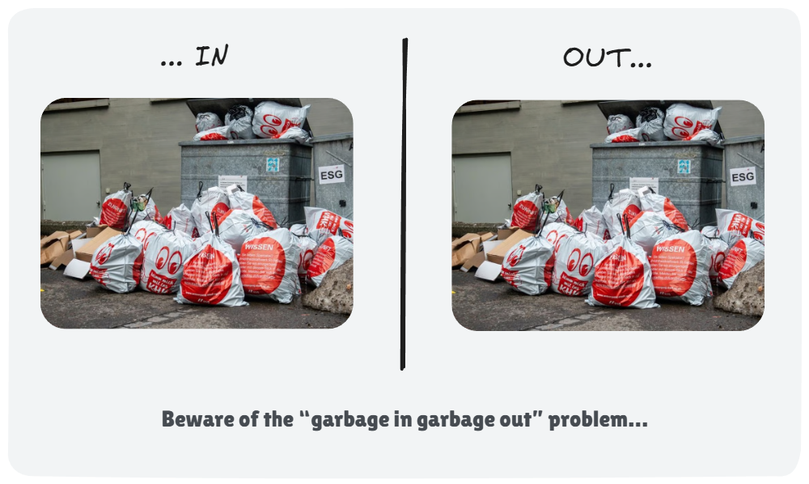
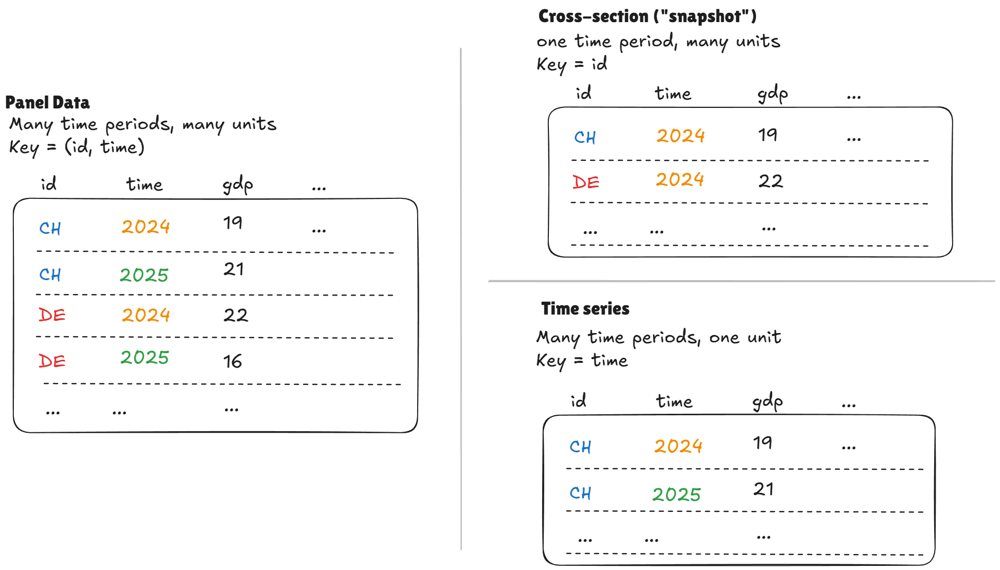
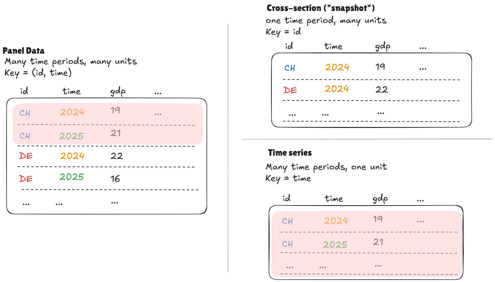
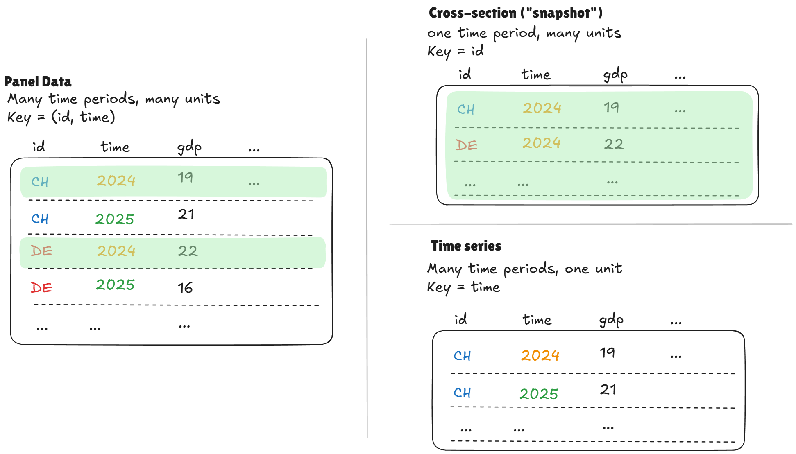

```{r set-options, echo=FALSE, message=FALSE, warning=FALSE, cache=FALSE}
options(width = 100)
library(knitr)
library(dplyr)
library(tidyr)
library(stringr)
```

# Welcome back!

# Recap of Part I

## Part I: Data, data processing, data structures
```{r pipeline 1, echo=FALSE, fig.align='center', out.width="80%", purl = FALSE}
include_graphics("../../img/data_science_pipeline.png")
```


## Part I: Our story so far (explained by AI...)

  - 🖥️Computers store data as bits (Bits → Bytes → Encoded Text)<br>
  - ✍🏻Text encodes meaning<br>
  - 📝Files encode structure (→ Structured Files like CSV, JSON, XML)<br>
  - 🗂️Structure is more or less flexible (→ rectangular data, hierarchical data)<br>
  - 🔄✋Structure is obtained automatically or manually (→ APIs vs local files)<br>
  - 💾R parses structure into memory. (→ R Parsing → R Data Structures)


## Your own Group Project{.nostretch}

{width="40%" fig-align="center"}


# Recap: non-rectangular data

## XML vs JSON: Structure and Syntax

:::: {.columns}

::: {.column width="50%"}

#### XML:

::: {style="font-size: 75%;"}
```{xml, echo = TRUE}
<person>
  <firstName>John</firstName>
  <lastName>Smith</lastName>
  <age>25</age>
  <address>
    <streetAddress>21 2nd Street</streetAddress>
    <city>New York</city>
    <state>NY</state>
    <postalCode>10021</postalCode>
  </address>
  <phoneNumber>
    <type>home</type>
    <number>212 555-1234</number>
  </phoneNumber>
  <phoneNumber>
    <type>fax</type>
    <number>646 555-4567</number>
  </phoneNumber>
</person>
```
:::

::: {style="font-size: 60%;"}
  - **Tags**: `<element>value</element>` or `<element attribute="value"/>`
  - **Repetition**: Multiple `<phoneNumber>` elements
  - **Verbose**: More characters for structure
:::

:::

::: {.column width="50%"}

#### JSON:

::: {style="font-size: 75%;"}
```{json, echo = TRUE}
{"firstName": "John",
  "lastName": "Smith",
  "age": 25,
  "address": {
    "streetAddress": "21 2nd Street",
    "city": "New York",
    "state": "NY",
    "postalCode": "10021"
  },
  "phoneNumber": [
    {
      "type": "home",
      "number": "212 555-1234"
    },
    {
      "type": "fax",
      "number": "646 555-4567"
    }
  ]
}
```
:::

::: {style="font-size: 60%;"}
  - **Objects**: `{}` for key-value pairs
  - **Arrays**: `[]` for sequences
  - **Compact**: Less verbose syntax
:::

:::
::::

## Working with XML and JSON in R {visibility="hidden"}

:::: {.columns}

::: {.column width="50%"}

#### XML in R:
```{r, echo = TRUE, eval = FALSE}
library(xml2)

# Read XML file
xml_data <- read_xml("data/person.xml")

# Extract specific elements with Xpath
name <- xml_text(xml_find_all(xml_data, ".//firstName"))
phone_numbers <- xml_text(xml_find_all(xml_data, ".//phoneNumber/number"))
phone_numbers <- xml_text(xml_children(xml_children(xml_data)[c(5,6)])[c(2,4)])

# Convert to data frame
person_df <- data.frame(
  firstName = name,
  phone = c(phone_numbers[1], phone_numbers[2])
)
```

```{r, echo = F, eval = T}
library(xml2)

# Read XML file
xml_data <- read_xml("../../data/person.xml")

# Extract specific elements with Xpath
name <- xml_text(xml_find_all(xml_data, ".//firstName"))
phone_numbers <- xml_text(xml_find_all(xml_data, ".//phoneNumber/number"))
phone_numbers <- xml_text(xml_children(xml_children(xml_data)[c(5,6)])[c(2,4)])

# Convert to data frame
person_df <- data.frame(
  firstName = name,
  phone = c(phone_numbers[1], phone_numbers[2])
)
person_df
```
:::

::: {.column width="50%"}

#### JSON in R:
```{r, echo = TRUE, eval = FALSE}
library(jsonlite)

# Read JSON file
json_doc <- fromJSON("data/person.json")

# Access elements directly
name <- json_doc$firstName
phones <- json_doc$phoneNumber$number

# Convert to data frame (automatic!)
person_df <- as.data.frame(json_doc)
```

```{r, echo = FALSE, eval = TRUE}
library(jsonlite)

# Read JSON file
json_doc <- fromJSON("../../data/person.json")

# Access elements directly
name <- json_doc$firstName
phones <- json_doc$phoneNumber$number

# Convert to data frame (automatic!)
person_df <- as.data.frame(json_doc)
person_df
```
:::
::::


## HTML documents/webpages: *semi-structured data*

:::: {.columns}

::: {.column width="50%"}

  - A webpage can contain HTML tables (*structured data*)...
  - ...but likely also contains just raw text (*unstructured data*).

#### Example in class: Web scraping
  - Parse a Wikipedia table from HTML using XPath and the R-package `rvest`

:::

::: {.column width="50%"}

#### Raw HTML structure:

```{html, echo = TRUE}
<table class="wikitable">
<tbody>
<tr>
  <th>Year</th>
  <th>GDP (billions of
    <a href="/wiki/Swiss_franc">CHF</a>)
  </th>
  <th>US dollar exchange</th>
</tr>
<tr>
  <td>1980</td>
  <td>184</td>
  <td>1.67 Francs</td>
</tr>
...
</tbody>
</table>
```


:::
::::

## Programmatic Data Access with REST APIs

  - **Structured data**: APIs return data in JSON/XML format
  - **HTTP requests**: Use GET, POST, PUT, DELETE methods
  - **Real-time data**: Access current information (stock prices, weather, economic indicators)
  - (**Authentication**: Often require API keys or tokens)
  - **Rate limiting**: Restrictions on number of requests per time period

##### **In R**: Use `httr2`, `jsonlite` packages to consume APIs


# Warm-up
## JSON files

::: {style="font-size: 70%;"}
You import the following json file using fromJSON() and store the file in the object `students` in R, i.e. <br> `students <- fromJSON("students.json")`. Which statements are TRUE?
:::

:::: {.columns}
::: {.column width="60%"}

::: {style="font-size: 65%;"}
```{json, echo = TRUE}
{
  "students": [
    {
      "id": 19091,
      "firstName": "Peter",
      "lastName": "Mueller",
      "grades": {
          "micro": 5,
          "macro": 4.5,
          "data handling": 5.5
          }
    },
    {
      "id": 19092,
      "firstName": "Anna",
      "lastName": "Schmid",
      "grades": {
          "micro": 5.25,
          "macro": 4,
          "data handling": 5.75
          }
    },
    {
      "id": 19093,
      "firstName": "Trevor",
      "lastName": "Noah",
      "grades": {
          "micro": 4,
          "macro": 4.5,
          "data handling": 5
          }
    }
  ]
}
```
:::
:::

::: {.column width="40%"}

::: {style="font-size: 60%;"}

- The object `students` is a list.
- `students$students$firstName[2]` returns "Anna"
- In JSON, the value for the "students" key is itself an object (key–value pair).
- In JSON, you have two ways of writing data: arrays and objects. Objects are key-value pairs, and arrays are ordered lists.
```
{
  "name": "Anna",              // a key "name" with a string value "Anna"
  "grades": [5, 5.5, 6]        // a key "grades" with an array value [5, 5.5, 6]
}
```
:::
:::
::::

## XML

Which statements are TRUE?

:::: {.columns}

::: {.column width="60%"}
::: {style="font-size: 65%;"}
```{xml, echo = TRUE, max.lines = 10}
<students>
  <student>
    <id>19091</id>
    <firstName>Peter</firstName>
    <lastName>Mueller</lastName>
    <grades>
      <micro>5</micro>
      <macro>4.5</macro>
      <dataHandling>5.5</dataHandling>
    </grades>
  </student>
  <student>
    <id>19092</id>
    <firstName>Anna</firstName>
    <lastName>Schmid</lastName>
    <grades>
      <micro>5.25</micro>
      <macro>4</macro>
      <dataHandling>5.75</dataHandling>
    </grades>
  </student>
  <student>
    <id>19093</id>
    <firstName>Trevor</firstName>
    <lastName>Noah</lastName>
    <grades>
      <micro>4</micro>
      <macro>4.5</macro>
      <dataHandling>5</dataHandling>
    </grades>
  </student>
</students>
```
:::
:::

::: {.column width="40%"}

::: {style="font-size: 60%;"}
  - 'students' is the root-node, 'grades' are its children
  - The siblings of Trevor Noah are Anna Schmid and Peter Mueller
  - This code would be an alternative, equivalent notation for the third student in the xml file above.
```{xml, echo = TRUE}
<student id="19093" firstName="Trevor" lastName="Noah">
      <grades micro="4" macro="4.5" dataHandling="5" />
</student>
```
:::
:::
::::


<!-- =================================================================================================================== -->

# Part II: Data preparation, analysis, and visualization

## The dataset is imported, now what?
```{r pipeline, echo=FALSE, fig.align='center', out.width="80%", purl = FALSE}
include_graphics("../../img/data_science_pipeline.png")
```


## The dataset is imported, now what?

- In practice: still a long way to go.
- Parsable, but messy data: inconsistencies, data types, missing observations, wide format.

<br>

##### **Goal** of data preparation: dataset is ready for analysis.


## Prepared data is ready in structure and content

:::: {.columns}

::: {.column width="50%"}

#### Structure

  - tidy format
  - **reshape** (wide <-> long), **bind**, **join**

#### Content
  - values are consistent within each variable,<br>variables are of proper data types
  - [**clean**]{.green}, remove **duplicates**, \ check **plausibility**, take care of **missings**

:::

::: {.column width="50%"}

<br>

::: {style="text-align: center;"}
```{r garbage2, echo=FALSE, out.width = "90%", fig.align='center',  purl=FALSE}
# include_graphics("../../img/dalle_garbageinout.png")

```
:::


:::
::::


<!-- Tidying Data: This step focuses on structuring data to be analysis-ready, often using principles from tidy data. -->
<!-- Reshaping: Converting data formats (wide-to-long or long-to-wide) to fit specific analytical needs. -->
<!-- Row Binding/Stacking: Combining datasets by stacking rows, often when data comes in separate parts. -->
<!-- Joining: Merging datasets by columns, combining information based on a shared key. -->
<!-- Data Cleaning: This step usually involves handling missing values, correcting errors, and standardizing formats, ensuring the data is accurate and reliable before moving to other steps. -->


## Tidy data: some vocabulary

#### A tidy dataset is tidy when...

  1. Each <span style="color:red">variable</span> is a <span style="color:red">column</span>; each column is a variable.
  2. Each <span style="color:green">observation</span> is a <span style="color:green">row</span>; each row is an observation.
  3. Each <span style="color:blue">value</span> is a <span style="color:blue">cell</span>; each cell is a single value.

<!-- - *Dataset*: Collection of *values* (numbers and strings). -->
<!-- - Every value belongs to a *variable* and an *observation*. -->
<!-- - *Variable*: Contains all values that measure the same underlying attribute across units. -->
<!-- - *Observation*: Contains all values measured on the same unit (e.g., a person). -->


::: aside
"Tidy datasets are all alike, but every messy dataset is messy in its own way." Check Hadley Wickam's [R4DS, "Tidying dataset"](https://r4ds.hadley.nz/data-tidy.html)
:::

## Tidy data

```{r tidydata, echo=FALSE, out.width = "90%", fig.align='center', purl=FALSE}
include_graphics("../../img/tidy-1.png")
```

::: aside
Source: [R4DS, "Tidying dataset"](https://r4ds.hadley.nz/data-tidy.html)
:::


## Tidy data is not trivial

In Economics, the definition of an **observation** can vary:

- Panel data (longitudinal data)
- Cross-sectional data
- Time series


## Tidy data is not trivial

::: {style="font-size: 0.925em;"}
#### Panel Data (Longitudinal Data)

  - Each unit observed repeatedly across multiple time periods.<br>
  - **Observation**: One unit at one specific time point (e.g., Person A in 2020, Person A in 2021).

#### Cross-Sectional Data

  - "Snapshot" of different units at the same moment.
  - **Observation**: One unit at a single point in time (e.g., Person A, Person B, Person C all measured in 2024).

#### Time Series Data

  - Single unit tracked over time
  - **Observation**: One measurement of the unit at each time period (e.g., Switzerland's GDP in 1990, 1991, 1992...).

:::


## Different data structures in Economics

```{r , echo=FALSE, out.width = "70%", fig.align='center'}

```


## Different data structures in Economics

```{r , echo=FALSE, out.width = "70%", fig.align='center'}

```


## Different data structures in Economics

```{r , echo=FALSE, out.width = "70%", fig.align='center'}

```


## Three examples of non-tidy data (1)

#### Messy 💩
```{r, echo = FALSE}
weather_data <- tibble(
  measure = c("Temperature", "Humidity"),
  `Jan 1` = c(20, 80),
  `Jan 2` = c(22, 78),
  `Jan 3` = c(21, 82)
)

# Viewing the dataset
weather_data
```

<br>

#### Tidy 😎

...

## Three examples of non-tidy data (1)

#### Messy 💩
```{r, echo = FALSE}
weather_data <- tibble(
  measure = c("Temperature", "Humidity"),
  `Jan 1` = c(20, 80),
  `Jan 2` = c(22, 78),
  `Jan 3` = c(21, 82)
)

# Viewing the dataset
weather_data
```

<br>

#### Tidy 😎
```{r, echo = FALSE}
# Tidying the dataset
tidy_weather <- weather_data %>%
  pivot_longer(cols = -measure, names_to = "Date", values_to = "Value") %>%
  pivot_wider(names_from = measure, values_from = Value)

# Viewing the tidy data
tidy_weather
```


## Three examples of non-tidy data (2)

#### Messy 💩
```{r, echo = FALSE}
temp_location_data <- tibble(
  year = c(2019, 2019, 2019),
  temperature_location = c("22C_London", "18C_Paris", "25C_Rome")
)

temp_location_data
```

<br>

#### Tidy 😎
```
homework..
```

```{r, echo = FALSE, include=FALSE}
# Tidying the dataset by separating the variables
tidy_temp_location <- data.frame(
  temp_location_data$year,
  str_split(temp_location_data$temperature_location,
            pattern = "_",
            simplify = TRUE)
)

names(tidy_temp_location) <- c("year", "temperature", "location")
```


## Three examples of non-tidy data (3)

#### Messy 💩
```{r, echo = FALSE}
grades_data <- data.frame(
  Student = c("Johannes", "Hannah", "Igor"),
  Econ = c(5, 5.25, 4),
  DataHandling = c(4, 4.5, 5),
  Management = c(5.5, 6, 6)
)

grades_data

```

<br>

#### Tidy 😎
```
homework..
```

```{r, echo = FALSE, include=FALSE}
tidy_grades <- grades_data %>%
  pivot_longer(cols = -Student, names_to = "Subject", values_to = "Grade")

tidy_grades
```


# The Tidyverse

## Our main tool in part II: the Tidyverse

:::: {.columns}

::: {.column width="60%"}
"The tidyverse is a collection of open source packages for the R programming language introduced by Hadley Wickham and his team that share an underlying design philosophy, grammar, and data structures of tidy data." (Wikipedia)

#### In this course, we will use tidyverse AND base R.
:::

::: {.column width="40%"}
```{r , echo=FALSE, out.width = "55%", fig.align='center',  purl=FALSE}
include_graphics("../../img/tidyverse.png")
```
:::
::::

## Tidyverse for data handling in R

```{r, echo=FALSE, out.width = "40%", fig.align='center', purl=FALSE, fig.cap = "Source: https://www.storybench.org/wp-content/uploads/2017/05/tidyverse.png"}
include_graphics("../../img/tidyverse_pipeline.png")
```


## A note: Tibbles are a modern version of data frames

:::: {.columns}

::: {.column width="50%"}

##### Similar!

- Data frames are used everywhere in `R`
- Tibbles are used in the `tidyverse`
- Both contain the exact same information.
- Small differences in the manipulation and representation of data.
- See [**Tibble vs. DataFrame**](https://jtr13.github.io/cc21fall1/tibble-vs.-dataframe.html#tibble-vs.-dataframe) and **Appendix lecture 4** for more details.

:::

::: {.column width="60%" style="font-size: 60%;"}

::: {style="max-height: 200px; overflow-y: auto;"}
```{r, eval=TRUE, echo=-1, message=FALSE, warning=FALSE}
library(tidyverse)

as.data.frame(swiss)
```
:::

```{r, eval=TRUE, echo=TRUE, message=FALSE, warning=FALSE}
as_tibble(swiss)
```

:::
::::


# Reshaping

## Reshaping: the concept

<!-- ```{r widetolong, echo=FALSE, out.width = "65%", fig.align='center',  purl=FALSE} -->
<!-- include_graphics("../../img/reshape2_dark.png") -->
<!-- ``` -->

```{r, echo=FALSE, out.width = "80%", fig.align='center', purl=FALSE, fig.cap="Long and wide data. Source: [Hugo Tavares](https://tavareshugo.github.io/r-intro-tidyverse-gapminder/09-reshaping/index.html)"}
include_graphics("../../img/longvswide.png")
```

## Wide vs Long Format: Key Differences

:::: {.columns}

::: {.column width="50%"}

#### **Long Format**
- **Structure**: Each measurement = one row
- **Variables**: Stacked vertically
- **Dimensions**: More rows, fewer columns
- **Analysis**: Better for statistical operations
- **Example**: Database-normalized format

```{r, echo = FALSE}
grades_wide <- data.frame(
  Student = c("Johannes", "Hannah", "Igor"),
  Econ = c(5.0, 5.25, 4.0),
  DataHandling = c(4.0, 4.5, 5.0),
  Management = c(5.5, 6.0, 6.0)
)
grades_long <- grades_wide %>%
  pivot_longer(cols = -Student, names_to = "Subject", values_to = "Grade")
grades_long
```

:::

::: {.column width="50%"}

#### **Wide Format**
- **Structure**: Each observation = one row
- **Variables**: Spread across multiple columns
- **Dimensions**: More columns, fewer rows
- **Analysis**: Easy for humans to read
- **Example**: Spreadsheet-style layout

```{r, echo = FALSE}
grades_wide
```

:::

::::


## Reshaping: implementation in `R`

- From wide to long: `melt()`, `gather()`,

👉 We'll use `tidyverse::pivot_longer()`.


- From long to wide: `cast()`, `spread()`,

👉 We'll use `tidyverse::pivot_wider()`.


## Reshaping: implementation in `R` with `tidyverse()`

```{r longvswideCode, echo=FALSE, out.width = "80%", fig.align='center', purl=FALSE, fig.cap="Long and wide data with code. Source: [Hugo Tavares](https://tavareshugo.github.io/r-intro-tidyverse-gapminder/09-reshaping/index.html)"}
include_graphics("../../img/longvswideCode.png")
```


## When to Use Wide vs Long Format

:::: {.columns}

::: {.column width="50%"}

#### **Use Long Format for:**

- **Data analysis** with tidyverse/ggplot2
- **Grouping and summarizing operations** (summarize, mutate by groups)
- **Time series analysis**
- **Following tidy data principles**
- **Creating visualizations** with multiple variables

:::

::: {.column width="50%"}

#### **Use Wide Format for:**

- **Data entry** and manual correction
- **Reports and tables** for presentation
- **Statistical models** like regressions where each predictor should be a separate column (`lm`), many machine learning functions, matrix multiplication
- **Spreadsheet analysis** (Excel-style operations)
- **Human readability** and quick scanning

:::
::::


<center>
##### Rule of thumb: Wide format for presentation, long format for analysis
</center>


# Stack and row-bind

## Stack/row-bind: the concept

```{r rowbinding, echo=FALSE, out.width = "55%", fig.align='center', purl=FALSE}
include_graphics("../../img/rowbinding_dark.png")
```

## Stack/row-bind: implementation in `R`

#### `rbind()` in base `R`

  - Requires that the data frames have the same column names and same column classes.

#### `bind_rows()` from `dplyr()`

  - Flexible: binds data frames with different column names and classes
  - Automatically fills missing columns with `NA`
  - Better performance, handles row names, handles factors
  - **Preferred** in most applications


## Stack/row-bind: code example

:::: {.columns}

::: {.column width="50%"}

Create three data frames
```{r, echo=TRUE}
subset1 <- data.frame(ID = c(1,2),
                      X = c("a", "b"),
                      Y = c(50,10))

subset2 <- data.frame(ID = c(3,4),
                      Z = c("M", "O"))

subset3 <- data.frame(ID = c(5),
                      X = c("c"),
                      Z = "P")
```

:::

::: {.column width="50%"}
Inspect
```{r, echo=TRUE}
subset1
subset2
subset3
```

:::
::::


## Stack/row-bind: code example

:::: {.columns}

::: {.column width="50%"}

#### Using `rbind()`
```{r, error=TRUE, echo = TRUE, eval=TRUE}
combined_df_rbind <- rbind(subset1, subset2, subset3)
combined_df_rbind
```

:::

::: {.column width="50%"}

#### Using `bind_rows()`
```{r, error=TRUE, echo = TRUE, eval=TRUE}
combined_df_bind_rows <- bind_rows(subset1, subset2, subset3)
combined_df_bind_rows
```

:::
::::


::: aside
The errors are due to the requirements of `rbind()`.
:::


# Duplicates and \ de-duplication

<style>
/* calories data set: blue output lines only (R output lines "##" get class .do) */
.reveal .df-calories pre code span.do { color: #64B5F6; }
</style>


## Duplicates: two examples 🫕

:::: {.columns}

::: {.column width="48%" style="font-size: 95%;"}

#### Orders {style="margin-top: 0 !important;"}

::: {.df-orders}
```{r, eval=TRUE, echo=-1, collapse=TRUE}
orders <- data.frame(
    order_id = rep(2031, 6),
    item_id = c(1001, 2014, 3001, 3001, 3026, 3022),
    item = c(
        "Moitié-Moitié Fondue", "Fendant Wine", "Dessert: meringues + dbl",
        "Dessert: meringues + dbl", "Water", "Espresso"
    ),
    quantity = c(1, 1, 1, 1, 1, 1),
    price_chf = c(24.00, 38.00, 21.00, 21.00, 3.00, 4.50)
)
orders
```
:::

:::


::: {.column width="48%" style="font-size: 95%;"}

::: {.fragment}
#### Calories {style="margin-top: 0 !important;"}

::: {.df-calories}
```{r, eval=TRUE, echo=-1, collapse=TRUE}
calories <- data.frame(
  item = c("Moitié-Moitié Fondue", "Moitié-Moitié Fondue",
           "Fendant", "Fendant", "Meringues + dbl cream"),
  unit = c("per 100 g", "per portion", "per dl", "per dl", "per portion"),
  kcal = c(380, 950, 70, 85, 725)
)
calories
```
:::
:::

:::
::::

##### Which rows are duplicates? Which ones should we remove?


## De-duplication: the trivial case


::: {.df-orders}
```{r, eval=TRUE, echo=TRUE, collapse=TRUE}
orders
```
:::

::: {.panel-tabset}

### 1. Count rows

::: {.df-orders}
```{r, eval=TRUE, echo=TRUE, collapse=TRUE}
nrow(orders)
```
:::

### 2. Find

::: {.df-orders}
```{r, eval=TRUE, echo=TRUE, collapse=TRUE}
duplicated(orders)

orders[duplicated(orders), ]
```
:::

- `duplicated()` (base R) flags only the duplicates from the second one. The first one stays `FALSE`.

### 3. Remove

::: {.df-orders}
```{r, eval=TRUE, echo=TRUE, collapse=TRUE}
orders_clean <- distinct(orders)
orders_clean <- unique(orders) # base R
orders_clean
```
:::

### 4. Check

::: {.df-orders}
```{r, eval=TRUE, echo=TRUE, collapse=TRUE}
nrow(orders_clean) - nrow(orders)
```
:::

:::


## De-duplication: the less trivial case

::: {.df-calories}
```{r, eval=TRUE, echo=TRUE, collapse=TRUE}
calories
```
:::

::: {.panel-tabset}

### 1. Exact duplicates?

::: {.df-calories}
```{r, eval=TRUE, echo=TRUE, collapse=TRUE}
duplicated(calories)
```
:::

- Not *exact* duplicates...

### 2. Check the key

::: {.df-calories}
```{r, eval=TRUE, echo=TRUE, collapse=TRUE}
# One row should be one item in one unit
count(calories, item, unit)
```
:::

- Keys are identified as the variables that make each observation unique, i.e. the **unit of observation**!

### 3. Look at the rows

::: {.df-calories}
```{r, eval=TRUE, echo=TRUE, collapse=TRUE}
filter(
  group_by(calories, item, unit),
  n() > 1
  )
```
:::

- This code will be explained in Lecture 8: group the data by `item` and `unit`, compute the number of observations per group, and subset/filter the rows with more than 1 observations in their group.

### 4. Keep one row


::: {.df-calories}

```{r, eval=FALSE, echo=TRUE, collapse=TRUE}
slice(calories, 1, .by = c(item, unit)) # The first row of each item and unit
slice_max(calories, kcal, n = 1, by = c(item, unit)) # The row with the highest kcal
```
:::

`slice` keeps rows by their row number. `slice_` have variants that keep rows based on different ways.
:::


## Notes on duplicates

#### Duplicates are tricky

- They end up taking a lot of time in the data cleaning pipeline
- Especially when merging (see next week)
- Many analytical mistakes are made because of duplicates.

#### Crucial questions:

- Which variables identify the unit of observation?
- And: which row has precedence?

##### Sometimes simply data-driven, sometimes it is driven by the research question/the knowledge of the data.

::: aside
Source: [The Epidemiologist R Handbook, chapter "De-duplication"](https://www.epirhandbook.com/en/new_pages/deduplication.html)
:::
