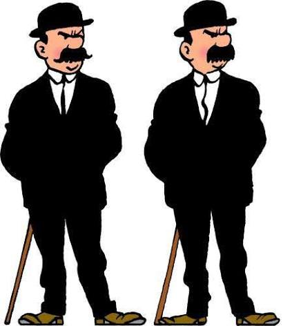
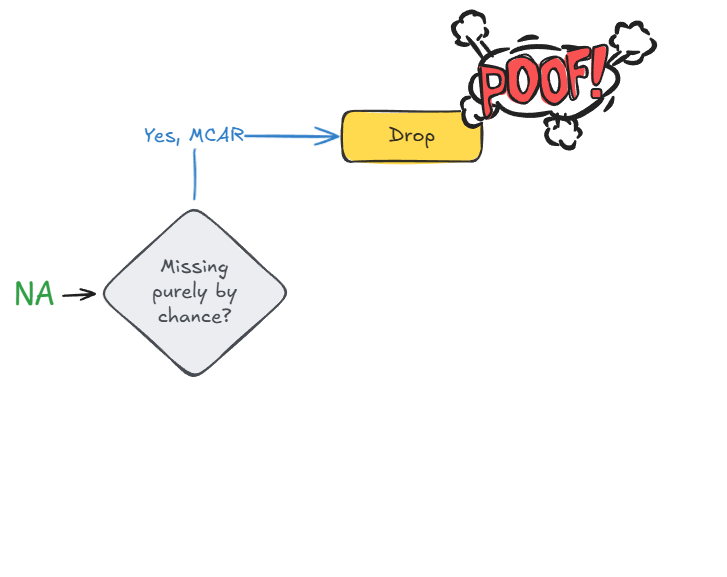
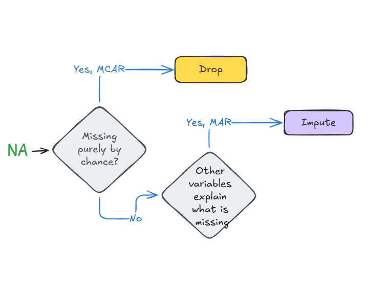
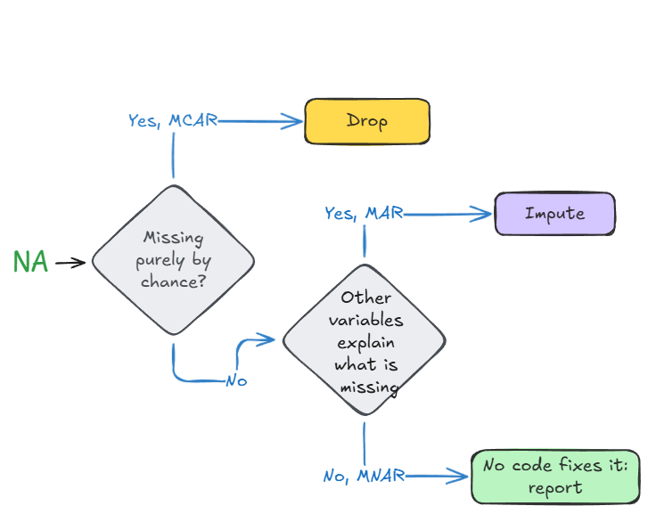

```{r set-options, echo=FALSE, message=FALSE, warning=FALSE, cache=FALSE}
options(width = 100)
library(knitr)
library(dplyr)
library(tidyverse)
library(tidyr)
```


# Warm up

## Reshaping: multiple/one/none answers correct

Consider the following data frame `schwiizerChuchi`. This dataset records the popularity ratings (on a scale of 1 to 10) of various Swiss dishes in different regions of Switzerland:

:::: {.columns}

::: {.column width="70%"}

```{r}
schwiizerChuchi <- data.frame(
  Region = c("Zurich", "Geneva", "Lucerne"),
  Fondue = c(8, 9, 7),
  Raclette = c(7, 8, 10),
  Rosti = c(9, 6, 8),
  Olma = c(10, 7, 8)
)
```


```{r}
schwiizerChuchiLong <- pivot_longer(schwiizerChuchi,
                                    cols = c(Fondue, Raclette, Rosti, Olma),
                                    values_to = "Popularity",
                                    names_to = "Dish")
```
:::

::: {.column width="30%"}

```{r garbage, echo=FALSE, out.width = "90%", fig.align='center',  purl=FALSE}
include_graphics("../../img/schwiizerchuchi.jpg")
```
:::
::::

::: {style="margin-top: -1em;"}
Which of the following statements is true?
:::

::: {style="font-size: 70%;"}

:::: {.columns}

::: {.column width="50%"}

- `nrow(schwiizerChuchiLong) == 12` returns `TRUE`
- `dim(schwiizerChuchiLong)` returns `c(3, 12)`
:::

::: {.column width="50%"}

- `dim(schwiizerChuchi)` returns `c(3, 12)`
- `mean(schwiizerChuchiLong$Raclette) == 8.333`

:::
::::
:::

<!-- ```{r}
temp_location_data <- data.frame(
  temperature_location = c("22C_London", "18C_Paris", "25C_Rome")
)
``` -->

<!-- ```{r, echo = FALSE, include=FALSE}
# Tidying the dataset by separating the variables
tidy_temp_location <- as.data.frame(
  str_split(temp_location_data$temperature_location,
            pattern = "_",
            simplify = TRUE)
)

names(tidy_temp_location) <- c("temperature", "location")
``` -->


<!-- ## Tidy data: essay question

Why is this data frame not tidy, and what would you do to make it tidy? Write down your reasoning in numbered steps. You can write down some exact code, some higher-level code concepts, or in plain text.

```{r}
grades_data <- data.frame(
  Student = c("Johannes", "Hannah", "Igor"),
  Econ = c(5, 5.25, 4),
  DataHandling = c(4, 4.5, 5),
  Management = c(5.5, 6, 6)
)
```

<br> -->

<!-- ```{r, echo = FALSE, include=FALSE}
tidy_grades <- grades_data %>%
  pivot_longer(cols = -Student, names_to = "Subject", values_to = "Grade")
``` -->


# Today

## Goals of today's lecture

1. Understand the concept of merging datasets.
2. Perform basic data manipulation in `dplyr`.
3. First steps in exploratory data analysis.


# Data Preparation: merging

## Merging (Joining) datasets

- Combine data of two datasets in one dataset.
- Needed: Unique identifiers for observations ('keys').


## Merging (joining) datasets

```{r setupjoin, echo=FALSE, out.width = "60%", fig.align='center', fig.cap= 'Join setup. Source: [R4DS](https://r4ds.hadley.nz/joins).', purl=FALSE}
include_graphics("../../img/join-setup.png")
```


## Merging (joining) datasets

```{r setupjoin2, echo=FALSE, out.width = "70%", fig.align='center', fig.cap= 'Join setup. Source: [R4DS](https://r4ds.hadley.nz/joins).', purl=FALSE}
include_graphics("../../img/join-setup2.png")
```


## Merging (joining) datasets using an <span style="color:#02934a;">inner join</span>

```{r innerjoin, echo=FALSE, out.width = "90%", fig.align='center', fig.cap= 'Inner join. Source: R4DS', purl=FALSE}
include_graphics("../../img/join-inner.png")
```


## Merging (joining) datasets using a <span style="color:#02934a;">left join</span>

```{r leftjoin, echo=FALSE, out.width = "90%", fig.align='center', fig.cap= 'Left join. Source: [R4DS](https://r4ds.hadley.nz/joins).', purl=FALSE}
include_graphics("../../img/join-left.png")
```


## Merging (joining) datasets using a <span style="color:#02934a;">right join</span>

```{r rightjoin, echo=FALSE, out.width = "90%", fig.align='center', fig.cap= 'Right join. Source: [R4DS](https://r4ds.hadley.nz/joins).', purl=FALSE}
include_graphics("../../img/join-right.png")
```


## Merging all x and all y using a <span style="color:#02934a;">full join</span>

```{r fulljoin, echo=FALSE, out.width = "90%", fig.align='center', fig.cap= 'Full join. Source: [R4DS](https://r4ds.hadley.nz/joins).', purl=FALSE}
include_graphics("../../img/join-full.png")
```


## The four fundamental joins are :

```{r vennjoin, echo=FALSE, out.width = "90%", fig.align='center', fig.cap= 'Join Venn Diagramm. Source: [R4DS](https://r4ds.hadley.nz/joins).', purl=FALSE}
include_graphics("../../img/join-venn.png")
```


## Row-matching behaviors in joins

:::: {.columns}

::: {.column width="30%"}

1. "One-to-one"
2. "Many-to-many"
3. "One-to-many"
4. "Many-to-one"

<!-- one-to-one: -->
<!-- A row from x can match at most 1 row from y. -->
<!-- A row from y can match at most 1 row from x. -->
<!-- one-to-many: -->
<!-- A row from x can match any number of rows in y. -->
<!-- A row from y can match at most 1 row from x. -->
<!-- many-to-one: -->
<!-- A row from x can match at most 1 row from y. -->
<!-- A row from y can match any number of rows in x. -->
<!-- many-to-many: -->
<!-- A row from x can match any number of rows in y. -->
<!-- A row from y can match any number of rows in x. -->

::: aside
**Always check how many rows are returned after your merge!** In `tidyverse`, warnings appear in case of "many-to-many". As of `dplyr 1.1.1`, no warning for one-to-many relationships.
:::

:::

::: {.column width="70%"}

```{r , echo=FALSE, out.width = "90%", fig.align='center', fig.cap = "One-to-many joins. Source: [R4DS](https://r4ds.hadley.nz/joins)" , purl=FALSE}
include_graphics("../../img/join-rowmatching.png")
```

:::
::::


## Filtering joins with the <span style="color:#02934a;">semi join</span> and the <span style="color:#02934a;">anti join</span>

:::: {.columns}

::: {.column width="50%"}

```{r , echo=FALSE, out.width = "90%", fig.align='center', fig.cap= 'The semi-join keeps rows in x that have one or more matches in y. Source: [R4DS](https://r4ds.hadley.nz/joins).',  purl=FALSE}
include_graphics("../../img/join-semi.png")
```

:::

::: {.column width="50%"}

```{r , echo=FALSE, out.width = "90%", fig.align='center', fig.cap= "The anti-join keeps rows in x that match zero rows in y. Source: [R4DS](https://r4ds.hadley.nz/joins).", purl=FALSE}
include_graphics("../../img/join-anti.png")
```

:::
::::


## Merging (joining) datasets: example

```{r message=FALSE}
# load packages
library(tidyverse)

# initiate data frame on persons personal spending
df_c <- data.frame(id = c(1:3,1:3),
                   money_spent= c(1000, 2000, 6000, 1500, 3000, 5500),
                   currency = c("CHF", "CHF", "USD", "EUR", "CHF", "USD"),
                   year=c(2017,2017,2017,2018,2018,2018))
df_c

```


## Merging (joining) datasets: example

```{r message=FALSE}
# initiate data frame on persons' characteristics
df_p <- data.frame(id = 1:4,
                   first_name = c("Anna", "Betty", "Claire", "Diane"),
                   profession = c("Economist", "Data Scientist",
                                  "Data Scientist", "Economist"))
df_p
```


## Merging (joining) datasets: example

```{r}
df_merged <- left_join(df_p, df_c, by="id")
df_merged
```


## Merging (joining) datasets: R

Overview by [R4DS](https://r4ds.hadley.nz/joins):

dplyr (tidyverse)  | base::merge
-------------------|-------------------------------------------
`inner_join(x, y)` | `merge(x, y)`
`left_join(x, y)`  | `merge(x, y, all.x = TRUE)`
`right_join(x, y)` | `merge(x, y, all.y = TRUE)`,
`full_join(x, y)`  | `merge(x, y, all = TRUE)`

::: aside
You are expected to know that `base::merge()` exists. For the exam, please focus on the `dplyr` functions.
:::


# Duplicates and \ de-duplication

<style>
/* calories data set: blue output lines only (R output lines "##" get class .do) */
.reveal .df-calories pre code span.do { color: #64B5F6; }
</style>


## Duplicates: two examples 🫕

:::: {.columns}

::: {.column style="width: 48%; font-size: 95%;"}

#### Orders {style="margin-top: 0 !important;"}

::: {.df-orders}
```{r, eval=TRUE, echo=-1, collapse=TRUE}
orders <- data.frame(
    order_id = rep(2031, 6),
    item_id = c(1001, 2014, 3001, 3001, 3026, 3022),
    item = c(
        "Moitié-Moitié Fondue", "Fendant Wine", "Dessert: meringues + dbl",
        "Dessert: meringues + dbl", "Water", "Espresso"
    ),
    quantity = c(1, 1, 1, 1, 1, 1),
    price_chf = c(24.00, 38.00, 21.00, 21.00, 3.00, 4.50)
)
orders
```
:::

:::


::: {.column style="width: 48%; font-size: 95%;"}

::: {.fragment}
#### Calories {style="margin-top: 0 !important;"}

::: {.df-calories}
```{r, eval=TRUE, echo=-1, collapse=TRUE}
calories <- data.frame(
  item = c("Moitié-Moitié Fondue", "Moitié-Moitié Fondue",
           "Fendant", "Fendant", "Meringues + dbl cream"),
  unit = c("per 100 g", "per portion", "per dl", "per dl", "per portion"),
  kcal = c(380, 950, 70, 85, 725)
)
calories
```
:::
:::

:::
::::

##### Which rows are duplicates? Which ones should we remove?


## De-duplication: the trivial case


::: {.df-orders}
```{r, eval=TRUE, echo=TRUE, collapse=TRUE}
orders
```
:::

::: {.panel-tabset}

### 1. Count rows

::: {.df-orders}
```{r, eval=TRUE, echo=TRUE, collapse=TRUE}
nrow(orders)
```
:::

### 2. Find

::: {.df-orders}
```{r, eval=TRUE, echo=TRUE, collapse=TRUE}
duplicated(orders)

orders[duplicated(orders), ]
```
:::

- `duplicated()` (base R) flags only the duplicates from the second one. The first one stays `FALSE`.

### 3. Remove

::: {.df-orders}
```{r, eval=TRUE, echo=TRUE, collapse=TRUE}
orders_clean <- distinct(orders)
orders_clean <- unique(orders) # base R
orders_clean
```
:::

### 4. Check

::: {.df-orders}
```{r, eval=TRUE, echo=TRUE, collapse=TRUE}
nrow(orders_clean) - nrow(orders)
```
:::
:::


## De-duplication: the less trivial case

::: {.df-calories}
```{r, eval=TRUE, echo=TRUE, collapse=TRUE}
calories
```
:::

::: {.panel-tabset}

### 1. Exact duplicates?

::: {.df-calories}
```{r, eval=TRUE, echo=TRUE, collapse=TRUE}
duplicated(calories)
```
:::

- Not *exact* duplicates...

### 2. Check the key

::: {.df-calories}
```{r, eval=TRUE, echo=TRUE, collapse=TRUE}
# One row should be one item in one unit
count(calories, item, unit)
```
:::

- Keys are identified as the variables that make each observation unique, i.e. the **unit of observation**!

### 3. Look at the rows

::: {.df-calories}
```{r, eval=TRUE, echo=TRUE, collapse=TRUE}
calories |>
    group_by(item, unit) |>
    filter(n() > 1)
```
:::

- `n()` is a `dplyr` function to compute the number of observations per group.

### 4. Keep one row

::: {.df-calories}

```{r, eval=FALSE, echo=TRUE, collapse=TRUE}
slice(calories, 1, .by = c(item, unit)) # The first row of each item and unit
slice_max(calories, kcal, n = 1, by = c(item, unit)) # The row with the highest kcal
```
:::

`slice` keeps rows by their row number. `slice_` have variants that keep rows based on different ways.
:::


## Notes on duplicates


::: {.columns}

::: {.column .column width="75%"}

#### Duplicates are tricky

- They end up taking a lot of time in the data cleaning pipeline
- Especially after merging
- Many analytical mistakes are made because of duplicates (speaking from experience 😨)

#### Crucial questions:

- Which variables identify the unit of observation?
- And: which row has precedence?

:::

::: {.column .column width="25%"}


```{r , echo=FALSE, out.width = "90%", fig.align='center', purl=FALSE}

```

:::

:::


##### Sometimes simply data-driven, sometimes driven by the research question/the knowledge of the data.

<!--::: aside
To know more: [The Epidemiologist R Handbook, chapter "De-duplication"](https://www.epirhandbook.com/en/new_pages/deduplication.html)
:::
-->


# Missing values

## Explicit and implicit missing values

#### **Explicit** missing values
- indicated with `NA` or `NaN`.
- test if missing with `is.na()` and `!is.na()`
- in R, sometimes happens with `NULL` or `Inf`
- older software has no proper missing-value code: it uses `99` or `-999`.

#### **Implicit** missing values
- an entire row of data is absent from the data.
- happens often with merge and pivot.


::: aside
Source: [R4DS, "Missing values"](https://r4ds.hadley.nz/missing-values.html). `NaN`: **N**ot **a** **N**umber. Generally behaves like `NA`, encountered with mathematical operations that have an indeterminate result (`0/0`).
:::


## Explicit and implicit missing values

```{r, eval=TRUE, echo=-1, collapse=TRUE}
stocks <- tibble(
    year  = c(2020, 2020, 2020, 2020, 2021, 2021, 2021),
    qtr   = c(1, 2, 3, 4, 2, 3, 4),
    price = c(1.88, 0.59, 0.35, NA, 0.92, 0.17, 2.66)
)
stocks
```

❓ Which value is implicitly and explicitly missing?


## The problem of missing values: potential bias


:::: {.columns}

::: {.column width="48%"}

##### 1. How big is the problem?

  - How many observations and variables are affected?
  - Is missingness clustered in groups or time periods?

:::

::: {.column width="4%"}
<div style="border-left: 20px solid #1c6b08ff; height: 100%; margin: 0 auto;"></div>
:::

::: {.column width="48%"}

##### 2. What do missing values represent?

  - Not collected, not available, not recorded, not applicable?


:::
::::

:::: {.columns}

::: {.column width="48%"}
##### 3. What is the missingness mechanism?

  - **MCAR**: missing completely at random
  - **MAR**: missing at random
    <!-- If the probability of being missing is the same for all cases, then the data are said to be missing completely at random (MCAR). The causes of the missing data are unrelated to the data. If the probability of being missing is the same only within groups defined by the observed data, then the data are missing at random (MAR)./ -->
  - **MNAR**: not missing at random<br><br>

:::

::: {.column width="4%"}
<div style="border-left: 20px solid #1c6b08ff; height: 100%; margin: 0 auto;"></div>
:::

::: {.column width="48%"}
##### 4. What are the risks for your analysis?

  - Missing values can introduce selection bias
  - Missing values can change distributions, shrink variances, or distort associations
:::
::::

::: aside
📖 [Flexible Imputation of Missing Data, Van Buuren, 2018](https://stefvanbuuren.name/fimd/)
:::


## Deal with missing values

:::: {.columns}
::: {.column width="45%"}

```{r , echo=FALSE, out.width = "100%", fig.align='center', purl=FALSE}

```

:::

::: {.column width="55%"}
#### Drop observations with missing values:<br>Complete case analysis or listwise deletion

::: {style="font-size: 85%;"}
  - `na.omit()`
  - `complete.cases(df)` tests if row is complete (no `NA`)
  - Many functions do this silently: `lm()` drops missings, `mean()` or `median()` return `NA` unless `na.rm = TRUE`
:::

:::
::::


## Deal with missing values

:::: {.columns}
::: {.column width="45%"}

```{r , echo=FALSE, out.width = "100%", fig.align='center', purl=FALSE}

```

:::

::: {.column width="55%"}

#### Imputation: replace missing values with a plausible value.

::: {style="font-size: 85%;"}
  - Fixed value: `mutate(x = ifelse(is.na(x), 0, x))` or `coalesce(x, 0)`
  - Value from another column: `coalesce(x, y)` takes the first non-missing value
  - Summary statistic: `mutate(x = ifelse(is.na(x), median(x, na.rm = TRUE), x))`
  - Last known value (time series, panels): `tidyr::fill(x)`
  - Other more advanced imputation methods: model-based imputation

:::
:::
::::


## Deal with missing values

:::: {.columns}

::: {.column width="45%"}

```{r , echo=FALSE, out.width = "100%", fig.align='center', purl=FALSE}

```


:::

::: {.column width="55%"}

#### Don't do anything and report

::: {style="font-size: 90%;"}
... in any case, **always report missing values**

:::
:::
::::


## My applied take on missing values

##### 1. **Keep in mind the source of missingness throughout your analysis**

::: {style="font-size: 90%;"}
  - In my experience, missingness is rarely random.
  - Common causes: data entry errors, expensive/unused variables, systematic non-response<br>
:::

##### 2. **Be aware of the trade-off between data loss and bias**

::: {style="font-size: 90%;"}
  - **Removing variables**: Loss of information. Usually ok, poorer analysis.
  - **Removing observations**: Risk of sample bias, reduced statistical power. More problematic.<br>
:::

#####  3. **Choose imputation methods wisely** (or, maybe, *don't bother*)

::: {style="font-size: 90%;"}
  - Simple imputation (mean/median): acceptable for small amounts of missing data
  - Multiple/model-based imputation: reserve for cases where data is highly valuable
  - Document your approach and justify complex methods
:::


## Imputing missing values be like
```{r echo= FALSE, out.width="100%", fig.align="center"}
include_graphics("../../img/meme_missingvalues_imputation.jpg")
```


# Cleaning to get consistent values

## Additional tools

To do additional cleaning and make each variable consistent, you will need tools that are tailored to the problem at hand:

- For strings and characters, `stringr` (str_replace(), str_detect(), etc.) or trim white spaces with `trimws()`, or convert to lower case with `tolower()`
- For dates, use `lubridate`
- For factors, clean levels and labels (see lecture 4)
- ....


## Our cleaning checklist

- **Tidy data**
- **Joins:** different sources are joined
- **Duplicates:** found, explained, removed
- **Missing values:** `-99`, `""`, `"NA"` recoded to `NA`
- **Consistent values:** `"Zürich"` = `"Zurich"`, one unit per variable


##

### See you in `R`!


##


<!-- # A primer in linear regression/OLS (if time) -->

<!-- ## Some vocabulary and notation -->

<!-- - *Dependent variable*: $y_i$. -->
<!-- - *Explanatory variable*: $x_i$. -->
<!-- - "All the rest": $u_{i}$ (the *'residuals'* or the 'error term'). -->

<!-- $y_{i}= \alpha + \beta x_{i} + u_{i}$. -->

<!-- ## Causality? -->

<!-- ## OLS Example: data -->


<!-- ```{r eval=FALSE} -->
<!-- # load the data -->
<!-- data(swiss) -->
<!-- # look at the description -->
<!-- ?swiss -->
<!-- ``` -->

<!-- ```{r echo=FALSE, message=FALSE, warning=FALSE} -->
<!-- # load the data -->
<!-- data(swiss) -->

<!-- ``` -->

<!-- ## Research question -->

<!-- - Do more years of schooling improve educational outcomes? -->
<!-- - Approximate educational success with the variable `Education` and educational outcomes with the variable `Examination`. -->
<!-- - Make use of the simple linear model to investigate whether more schooling improves educational outcomes (on average)? -->


<!-- ## Model specification -->

<!-- $Examination_{i}= \alpha + \beta Education_{i}$, -->

<!-- - Intuitive hypothesis: $\beta$ is positive, indicating that a higher share of draftees with more years of schooling results in a higher share of draftees who reach the highest examination mark. -->
<!-- - *Problems*? -->


<!-- ## Model specification -->

<!-- To formally acknowledge that other factors might also play a role, we extend our model with the term $u_{i}$. For the moment, we thus subsume all other potentially relevant factors in that term: -->

<!-- $Examination_{i}= \alpha + \beta Education_{i} + u_{i}$. -->


<!-- ## Raw data -->


<!-- ```{r} -->
<!-- plot(swiss$Education, swiss$Examination) -->
<!-- ``` -->


<!-- ## Derivation and implementation of OLS estimator -->

<!-- From the model equation we easily see that these 'differences' between the predicted and the actual values of $y$ are the remaining unexplained component $u$: -->

<!-- $y_{i}-\hat{\alpha}-\hat{\beta} x_i=u_i$. -->

<!-- Hence, we want to minimize the *sum of squared residuals (SSR)*: $\sum{u_i^2}=\sum{(y_{i}-\hat{\alpha}-\hat{\beta} x_i)^2}$. Using calculus, we define the two first order conditions: -->

<!-- $$\frac{\partial SSR}{\partial \hat{\alpha}}=\sum{-2(y_{i}-\hat{\alpha}-\hat{\beta} x_i)}=0$$ -->

<!-- $$\frac{\partial SSR}{\partial \hat{\beta}}=\sum{-2x_i(y_{i}-\hat{\alpha}-\hat{\beta} x_i)}=0$$ -->


<!-- ## Derivation and implementation of OLS estimator -->

<!-- The first condition is relatively easily solved by getting rid of the $-2$ and considering that  $\sum{y_i}=N\bar{y}$: -->
<!-- $\hat{\alpha}=\bar{y}-\hat{\beta}\bar{x}$. -->


<!-- ## Derivation and implementation of OLS estimator -->

<!-- By plugging the solution for $\hat{\alpha}$ into the first order condition regarding $\hat{\beta}$ and again considering that $\sum{y_i}=N\bar{y}$, we get the solution for the slope coefficient estimator: -->

<!-- $\frac{\sum{x_{i}y_{i}}-N\bar{y}\bar{x}}{\sum{x_i^2}-N\bar{x}^2}$. -->


<!-- ## Implement OLS in R! -->


<!-- ```{r} -->

<!-- # implement the simple OLS estimator -->
<!-- # verify implementation with simulated data from above -->
<!-- # my_ols(y,x) -->
<!-- # should be very close to alpha=30 and beta=0.9 -->
<!-- my_ols <- -->
<!--   function(y,x) { -->
<!--     N <- length(y) -->
<!--     betahat <- (sum(y*x) - N*mean(x)*mean(y)) / (sum(x^2)-N*mean(x)^2) -->
<!--     alphahat <- mean(y)-betahat*mean(x) -->

<!--     return(list(alpha=alphahat,beta=betahat)) -->
<!--   } -->

<!-- # estimate effect of Education on Examination -->
<!-- estimates <- my_ols(swiss$Examination, swiss$Education) -->
<!-- estimates -->
<!-- ``` -->


<!-- ## Simple visualisation -->

<!-- ```{r} -->
<!-- plot(swiss$Education, swiss$Examination) -->
<!-- abline(estimates$alpha, estimates$beta, col="red") -->
<!-- ``` -->


<!-- ## Regression toolbox in R -->


<!-- ```{r} -->
<!-- estimates2 <- lm(Examination~Education, data=swiss) -->
<!-- estimates2 -->
<!-- ``` -->
<!-- With one additional line of code we can compute all the common statistics about the regression estimation: -->

<!-- ```{r} -->
<!-- summary(estimates2) -->
<!-- ``` -->


---

