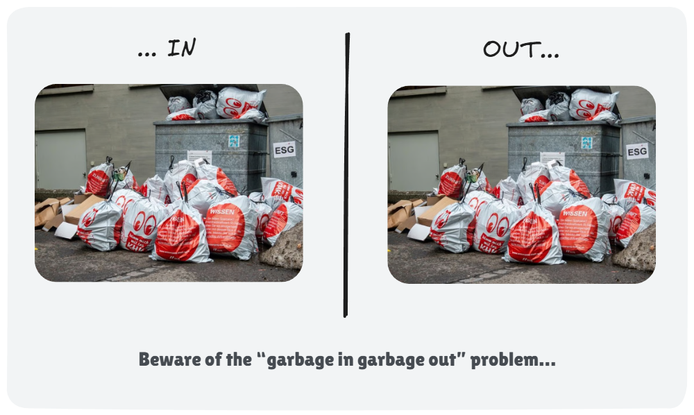
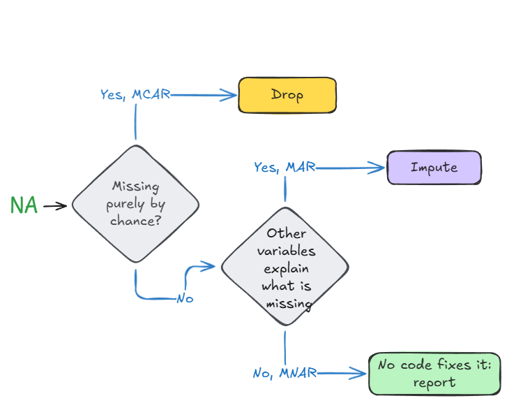
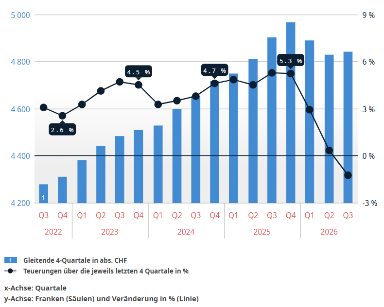

```{r set-options, echo=FALSE, message=FALSE, warning=FALSE, cache=FALSE}
options(width = 100)
library(knitr)
library(dplyr)
library(tidyverse)
library(tidyr)
```


# Recap and warmup

## Data preparation and cleaning

:::: {.columns}

::: {.column width="50%"}

##### Know how to prepare a dataset for analysis

::: {style="font-size: 0.95em;"}
  - Structure data: tidy data
  - Manipulate data frames with `dplyr`
  - Reshape data frames
  - Combine data frames
  - Clean data: find duplicates, handle missing values, make values consistent
:::
:::

::: {.column .fragment width="50%"}

####

```{r garbage2, echo=FALSE, out.width = "100%", fig.align='center',  purl=FALSE}
# include_graphics("../../img/dalle_garbageinout.png")

```
:::
::::


## Clean and manipulate data

```{r, echo=FALSE, out.width = "90%", fig.align='center', fig.cap = 'Source: [Intro to R for Social Scientists](https://jaspertjaden.github.io/course-intro2r/week3.html)', purl=FALSE}
include_graphics("../../img/dplyr_blocks.png")
```


## Clean and manipulate data: your turn  🫵


Consider the following data frame:

```
main_dataset
  city        temp  scale conversion_factor
1 StGallen    12 Celsius 1.0000000
2 Zürich      14 Celsius 1.0000000
3 Detroit     40 Fahrenheit 0.5555556
```

Select all the statements that are true.


::: {style="font-size: 0.8em;"}

::: {.columns}

::: {.column}
```{r, eval = FALSE}
main_dataset |>
  mutate(temp_celsius = if_else(
    scale == "Fahrenheit", (temp-32) * conversion_factor, temp)
  )
```
replaces the variable `temp` with `temp_celsius`
<!-- #NO -->
:::

::: {.column}
```{r, eval = FALSE}
main_dataset |>
  mutate(temp_celsius = if_else(
    scale == "Fahrenheit", (temp-32) * conversion_factor, temp)
  )
```
has 3 rows and 5 columns
<!-- YES -->
:::

:::


::: {.columns}
::: {.column}
```{r, eval = FALSE}
main_dataset |>
  summarize(mean_temp = mean(temp), min_temp = min(temp))
```
returns a tibble containing 2 columns and 1 row
<!-- YES -->
:::

::: {.column}
```{r, eval = FALSE}
main_dataset |>
  summarize(mean_scale = mean(scale), sd_scale = sd(scale))
```
is a good way to get summary statistics for the variable `scale`
<!-- NO -->
:::
:::

:::


## OK Boomer

:::: {.columns}

::: {.column width="50%"}
```{r, echo=FALSE, out.width = "90%", fig.align='center', purl=FALSE}
include_graphics("../../img/genzplyr.png")
```

:::

::: {.column width="50%"}
```{r, echo=FALSE, out.width = "90%", fig.align='center', purl=FALSE}
include_graphics("../../img/genzplyr2.png")
```
:::
::::

::: aside
`anti_join()` -> `ghost()`	(i.e. "*forget about those who don’t vibe with you*"). See [Hadley Wickham's Genzplyr](https://hadley.github.io/genzplyr/)
:::


## Reshape and stack datasets

::: {.columns}
::: {.column}

#### From wide to long and vice-versa
```{r longvswideCode, echo=FALSE, out.width = "80%", fig.align='center', purl=FALSE, fig.cap="Long and wide data. Source: [Hugo Tavares](https://tavareshugo.github.io/r-intro-tidyverse-gapminder/09-reshaping/index.html)"}
include_graphics("../../img/longvswideCode.png")
```
:::

::: {.column}

#### Bind or stack rows using `bind_rows()`

```{r, echo=FALSE, out.width = "80%", fig.align='center', purl=FALSE}
include_graphics("../../img/rowbinding_dark.png")
```

:::
:::


## Joining dataset

dplyr (tidyverse)  | base::merge
-------------------|-------------------------------------------
`inner_join(x, y)` | `merge(x, y)`
`left_join(x, y)`  | `merge(x, y, all.x = TRUE)`
`right_join(x, y)` | `merge(x, y, all.y = TRUE)`,
`full_join(x, y)`  | `merge(x, y, all = TRUE)`


::: aside
Source: [R4DS](https://r4ds.hadley.nz/joins). You are expected to know that `base::merge()` exists. For the exam, please focus on the `dplyr` functions.
:::


## Joining dataset: your turn 🫵🧠

Consider the following code:

```{r, eval = FALSE}
temperature_conversions <- data.frame(conversion_factor = c(5/9, 1),
                                      scale = c("Fahrenheit", "Celsius"))

temperature <- data.frame(city = c("StGallen", "Zürich", "Detroit"),
                          temp = c(12, 14, 21),
                          scale = c("Cel", "Cel", "F"))
```

Select statements that are true:

-   [`inner_join(temperature, temperature_conversions, by="scale")` returns a data frame with 3 rows.]{style="font-size: smaller;"}
-   [`left_join(temperature, temperature_conversions, by="scale")` returns a data frame with 3 rows.]{style="font-size: smaller;"}
-   [`full_join(temperature, temperature_conversions, by="scale")` returns a data frame with 3 rows.]{style="font-size: smaller;"}


## Missing Values

:::: {.columns}

::: {.column width="60%"}

<br>

::: {style="font-size: 90%;"}

1. Keep in mind the **source of missingness throughout your analysis**:

   ::: {style="font-family: monospace; font-size: 0.85em; line-height: 1.2;"}
   | \- Value is known but recorded badly
   | \- Value is unknown and completely missing at random (MCAR)
   | \- Value is unknown and missing at random (MAR)
   | \- Value is unknown and not missing at random (MNAR)
   :::

2. Be aware of the **trade-off between data loss and bias**
3. **Choose imputation methods wisely** (or, maybe, don't bother)

:::

:::

::: {.column width="40%"}
```{r echo= FALSE, out.width="100%", fig.align="center"}

```

:::
::::


## More on missing values

##### As I prepared the course, I realized Lecture 8 was lacking examples.

::: {.columns}

::: {.column width="40%"}

```{r echo= FALSE, out.width="80%", fig.align="center"}
include_graphics("../../img/meme_missingvalues_imputation.jpg")
```

:::
::: {.column width="60%"}

####

- Please check the [Appendix on Missing values](#appendix-missing-values).
- It walks you through the algorithm with some examples of my own (and of [Van Buuren, 2018](https://stefvanbuuren.name/fimd/))
- This would make the concepts developed in Lecture 8 concrete.
- Exam relevant 😉

:::
:::


## Question on merging dataframes {visibility="hidden"}

:::: {.columns}

::: {.column width="50%"}
::: {style="font-size: 80%;"}

Consider the two following dataframes:

```
> df_family_work <- data.frame(
+   year     = c(2023,2024,2023,2023,2024,2023,2024),
+   name     = c("Peter", "Peter", "Lois", "Lois", "Stewie",
+               "Stewie", "Stewie"),
+   hours    = c(10, 5, 20, 8, 12, 15, 4)
+ )
> df_family_work
  year   name hours
1 2023  Peter    10
2 2024  Peter     5
3 2023   Lois    20
4 2023   Lois     8
5 2024 Stewie    12
6 2023 Stewie    15
7 2024 Stewie     4


> df_family_budget <- data.frame(
+   name     = c("Peter","Peter","Lois","Stewie","Meg","Meg"),
+   year        = c(2023,2024,2023,2023,2023,2024),
+   budget_k    = c(120, 140,  90, 160, 110, 130)
+ )
> df_family_budget
    name year budget_k
1  Peter 2023      120
2  Peter 2024      140
3   Lois 2023       90
4 Stewie 2023      160
5    Meg 2023      110
6    Meg 2024      130
```
:::
:::

::: {.column width="50%"}

::: {style="font-size: 80%;"}
Now consider the following lines of code. Describe what these lines of code do. What would be the output? What is the problem with the first line? Is `j3` similar to `j4`, and how so?

```
j1 <- left_join(df_family_work, df_family_budget, by = "name")

j2 <- left_join(df_family_work, df_family_budget, by = c("name", "year"))

j3 <- inner_join(df_family_work, df_family_budget, by = c("name", "year"))

j4 <- left_join(df_family_work, df_family_budget, by = "name")  |>
  filter(year.x == year.y)  |>
  select(-year.y)  |>
  rename(year = year.x)
```
:::
:::
::::


## A "weird" dataset {visibility="hidden"}

  1. Is this dataset tidy?
  2. Is this dataset long or wide?
  3. What are the correct arguments to pivot it?
  4. Is this structure useful?

```{r, echo = F}
weird_df <- data.frame(last_name = c("Wayne", "Trump", "Marx",
                                     "Wayne", "Trump", "Marx",
                                     "Wayne", "Trump", "Marx"),
                       first_name = c("John", "Melania", "Karl",
                                      "John", "Melania", "Karl",
                                      "John", "Melania", "Karl"),
                       gender = c("male", "female", "male",
                                  "male", "female", "male",
                                  "male", "female", "male"),
                       value = c("150000", "250000", "10000",
                                 "2000000", "5000000", "NA",
                                 "50", "25", "NA"),
                       variable = c("income", "income", "income",
                                    "assets", "assets", "assets",
                                    "age", "age", "age"),
                       stringsAsFactors = FALSE)
weird_df
```


# Exploratory Data Analysis and Descriptive Statistics

## Goals for the next two lectures

1. Know how to conduct exploratory data analysis (EDA) using a real-life example.
2. Visualize data using tables.
3. Visualize data using the grammar of graphics.
4. Produce effective data visualization.


## {class="inverse"}

"To not mislead others and not embarrass yourself, know your data".*<br><br>[*"Statistics for Public Policy" by Jeremy G. Weber, 2024.]{style="font-size: 60%; font-weight: normal;"}


## Exploratory Data Analysis (EDA) is the first step of data analysis

- 🔎 Get a first understanding of your dataset.
- Show **key aspects of data** by modelling, transforming, and visualizing your data.
  - Investigate the quality and reliability of your data.
  - Inform your own statistical analysis.
  - Inform audience (helps understand analytics parts).
- ... which in turns generates new questions about your dataset (creative process 🎨).


## Three questions to ask your dataset

::: {style="font-size: 95%;"}

##### 1. What is the underlying structure of your dataset?

  - **Unit of observation** and number of observations
  - **What variables measure**: USD or PPP? "Intelligence" or IQ?
  - **Quality**: how were the data collected? Which values are missing, and why?

##### 2. What type of variation occurs within my variables?

- **Typical values**: mean, mode, range, standard deviation, missing values.
- **Surprising values**: outliers, anomalies, unusual patterns.

##### 3. What type of covariation occurs between my variables?

- **Covariation** and **Patterns**.
:::


::: {style="font-size: 60%;"}
Sources: [R4DS Chapter 10](https://r4ds.hadley.nz/eda).
:::


## EDA: first steps in `R`

- Quick overview: `summary()`, `str()`, `glimpse()` (`dplyr`)
- Cross-tabulation: `table()`
- Summarizing tools: `skimr`, `summarytools`, `janitor` (also cleaning)


## EDA: first steps in `R`

#### 1. Functions to compute statistics <br>

  - e.g., `mean()`, `min()`, `max()`

<br>

####  2. Functions to *apply* the statistics function to one or several columns in a tidy dataset.

  - Including all values in a column.
  - By group (observation categories, e.g. by location, year, etc.)

:::: aside
`summary()` in `base`; `summarize()` in `tidyverse`; `group_by()` in `tidyverse`; `sapply()`, `apply()`, `lapply()`, etc. in `base`; `skimr` package; etc.
::::


# Let's get real

## Exploring Swiss healthcare costs

```{r, eval = FALSE, echo = FALSE}
library(readxl)

url <- "https://mokke-livingdocs.bagapps.ch/data/zeitreihen_bh/bh_total_kt_de.xlsx"
tmp <- tempfile(fileext = ".xlsx")
download.file(url, tmp, mode = "wb")   # mode = "wb" is needed on Windows

raw <- read_excel(tmp, col_names = FALSE)
names(raw) <- c("canton", 1997:2024)

costs <- raw |>
  mutate(sex = case_when(
    str_detect(canton, "(Total)")  ~ "total",
    str_detect(canton, "(Männer)") ~ "men",
    str_detect(canton, "(Frauen)") ~ "women"
  )) |>
  fill(sex) |>
  filter(str_detect(canton, "^[A-Z]{2}$")) |>       # keep CH + 26 cantons
  mutate(across(-c(canton, sex), as.numeric)) |>    # 1997 was read as text
  pivot_longer(`1997`:`2024`, names_to = "year", values_to = "cost_pc") |>
  mutate(year = as.integer(year))

glimpse(costs)

cantons <- tribble(
  ~canton, ~region,
  "ZH","German", "BE","German", "LU","German", "UR","German", "SZ","German",
  "OW","German", "NW","German", "GL","German", "ZG","German", "FR","French",
  "SO","German", "BS","German", "BL","German", "SH","German", "AR","German",
  "AI","German", "SG","German", "GR","German", "AG","German", "TG","German",
  "TI","Italian","VD","French", "VS","French", "NE","French", "GE","French",
  "JU","French"
)

costs <- costs |>
  left_join(cantons, join_by(canton))

# save the cleaned data (read on the next slides)
writexl::write_xlsx(costs, "data/health_costs_canton.xlsx")
```


::: {.columns}

::: {.column}

#### We will explore the **Monitoring of ongoing cost development** dataset

  - Current trends in gross benefits per person by canton of residence and cost group.
  - 4 updates per year.
  - Time series by cost group, age group and canton from 1997.
  - Data extracted on 21.11.2026, available on the [FOPH Website](https://www.bag.admin.ch/de/monitoring-der-krankenversicherungs-kostenentwicklung-mokke)

:::

::: {.column}

```{r echo= FALSE, out.width="100%", fig.align="center"}

```

:::
:::

##

{width=80% fig-align="center"}


## Load and check

::: {.columns}

::: {.column}

#### Load and check first rows

```{r, collapse = TRUE}
library(readxl)
costs <- read_excel("../../data/health_costs_canton.xlsx")
```

```{r, collapse = TRUE}
head(costs)
```
:::

::: {.column}

#### Use `glimpse()` and `dim()`
```{r collapse = TRUE}
glimpse(costs)
```
```{r collapse = TRUE}
dim(costs)
```
2268 rows, 5 columns
:::
:::


## Call `summary()`

```{r collapse = TRUE}
summary(costs)
```

#### Check first difference between characters and numeric variables

  - 5 variables, 3 characters, 2 numeric
  - **Characters**: 27 unique cantons, 3 unique sexes, 3 unique regions with 84 `NA`s
  - **Numeric**: year from 1997 to 2024, costs from 977.9 to 6488.0


## [Use `skimr`: "a frictionless approach to summary statistics"]{style="font-size: 90%;"}

```{r eval = FALSE, echo = TRUE, collapse = TRUE, skimr_include_summary=FALSE}
library(skimr)
skim(costs)
```

::: {style="font-size: 50%"}
```{r echo = FALSE, collapse = TRUE, skimr_include_summary=FALSE}
library(skimr)
skim_without_charts(costs)
```
:::

::: aside
Here printed without `skimr`'s summary subtable and without charts. Check the [`skimr` Package Vignette](https://docs.ropensci.org/skimr/) for more customization.
:::


## Use `summarytools` {.scrollable}

```{r eval = FALSE, echo = TRUE, collapse = TRUE}
library(summarytools)
dfSummary(costs)
```

::: {style="font-size: 50%;"}
```{r, results='asis', echo = FALSE}
library(summarytools)
print(dfSummary(costs,
                graph.magnif = 0.6,          # smaller mini-plots
                valid.col = FALSE,           # drop the "Valid" column
                max.distinct.values = 3,     # list 3 cantons, then "[24 others]"
                varnumbers = FALSE),         # drop the "No" column
      method = "render", headings = FALSE, bootstrap.css = FALSE)
```
:::


## What is the unit of observation?

::: {.fragment}

- Unit of observation: **canton x year** or **canton x gender x year**<br>(one measurement per canton per year, for the population and per gender).
- This is a **panel data**.


::: {.columns}
::: {.column}
**One observation per canton, year, sex**
```{r collapse = TRUE}
costs |>
    count(canton, year, sex) |>
    head(6)
```
:::

::: {.column}
**No duplicates at the unit of observation level**
```{r collapse = TRUE}
costs |>
    summarize(n = n(), .by = c(canton, year, sex)) |>
    filter(n > 1)
```
:::
:::

:::


## What is the unit of observation?

::: {.columns}

::: {.column width="60%"}

```{r collapse = TRUE}
costs  |>
  group_by(region, canton, sex)  |>
  summarize(
    n_distinct(year),
    min(year),
    max(year)
  )
```

:::

::: {.column width="40%"}

#### We check **whether the panel is complete**: min, max, number of distinct years per region x canton x sex

- 81 units: 1 for the country, 2 for the country x sex, 26 x 1 for population, 52 for canton x sex.

:::

:::


## What to do with missing values?<br>What is the source of missingness?

::: {.fragment}

#### We saw that there were 84 `NA`s in the region variable.

::: {.columns}

::: {.column  width="40%"}

```{r collapse = TRUE}
costs |>
    count(region)

costs |>
    count(region, canton) |>
    filter(is.na(region))

costs <- costs |>
    mutate(region = coalesce(region, "CH"))
```

:::
::: {.column}

- It is clear that the `NA` in the region is for the region `CH`.
- Case of **value known but recorded badly**. Replace with "CH".

:::
:::

:::


## What do variables measure?

::: {.fragment}

- All variables are straightforward, but the variable costs needs clarification.
- The data description says: **gross benefits**. We need to look up what that is (OBSAN):

> "Gross costs of the compulsory health insurance in Switzerland are the total costs billed by healthcare providers for covered services before deducting patient cost-sharing (franchise, deductible/co-payment, and hospital stay contributions)"

- No mention whether it is nominal or real prices. Currency is CHF.

:::


## What do variables measure?

#### Ranges and distributions

::: {.columns}

::: {.column}

```{r collapse = TRUE}
costs |>
  filter(canton != "CH", sex == "total") |>
  summarise(
    n         = n(),
    n_missing = sum(is.na(cost_pc)),
    mean      = mean(cost_pc),
    median    = median(cost_pc),
    min       = min(cost_pc),
    max       = max(cost_pc),
    .by = canton
  )  |>
  head(5)
```

:::

::: {.column}

```{r collapse = TRUE}
costs |>
    filter(canton != "CH", sex == "total") |>
    summarise(
        n = n(),
        n_missing = sum(is.na(cost_pc)),
        mean = mean(cost_pc),
        median = median(cost_pc),
        min = min(cost_pc),
        max = max(cost_pc),
        .by = year
    ) |>
    head(5)
```

:::

:::


## What type of variation occurs within my variables?

#### Typical values (here for a typical canton)

```{r collapse = TRUE}
cantons_total <- costs |>
    filter(canton != "CH", sex == "total")

cantons_total |>
  filter(year %in% c(1997, 2024)) |>
  group_by(year) |>
  summarise(
    mean = mean(cost_pc),
    median = median(cost_pc),
    min = min(cost_pc),
    max = max(cost_pc),
    sd = sd(cost_pc)
  )
```

A typical canton costs about 4,400 CHF per insured person in 2024, 2.6 times more than in 1997.


## What type of variation occurs within my variables?

#### Which cantons are unusual in their costs?

```{r collapse = TRUE}
cantons_total |>
  filter(year == 2024) |>
  slice_max(cost_pc, n = 3)

cantons_total |>
  filter(year == 2024) |>
  slice_min(cost_pc, n = 3)
```

An outlier is not an error! Ticino and Geneva are really expensive... just google it to confirm.


## What type of variation occurs within my variables?

#### We have a panel data, so it's good to look at the trends over time.

- Use `lag()` in an arranged (❗) and grouped data frame to get typical growth rates.

::: {.columns}

::: {.column}

```{r collapse = TRUE}
growth <- cantons_total |>
    arrange(canton, year) |>
    group_by(canton) |>
    mutate(
      lag = lag(cost_pc),
      growth = cost_pc / lag - 1) |>
    ungroup()

growth
```

:::

::: {.column}

```{r collapse = TRUE}
growth |>
    summarise(
        mean = mean(growth, na.rm = TRUE),
        median = median(growth, na.rm = TRUE),
        min = min(growth, na.rm = TRUE),
        max = max(growth, na.rm = TRUE)
    )
```
Costs grow by about 3.5% per year in a typical canton.

:::
:::


## What type of variation occurs within my variables?

::: {.columns}

::: {.column}

```{r collapse = TRUE}
growth |>
    filter(abs(growth) > 0.10) |>
    arrange(desc(abs(growth))) |>
    head(10)
```

:::

::: {.column}

```{r collapse = TRUE}
growth |>
    filter(growth < 0) |>
    count(year) |>
    arrange(-n)
```

:::
:::

*Strange*: Fribourg 1998 (−12%) and growth rates > 10% are suspicious; 2020 is COVID.


## What type of variation occurs within my variables?

#### Check variation per gender

```{r collapse = TRUE}
costs |>
  filter(year %in% c(1997, 2024), canton == "CH") |>
  summarise(
    mean_cost  = mean(cost_pc),
    n_cantons  = n(),
    .by = c(year, sex)
  ) |>
  arrange(sex, year)
```

Women are 1013 CHF more expensive than men in 2024, 662 in 1997. Is this plausible?


## {class="inverse"}

😮‍💨


# Visualizing data

##

> "The first thing to do with data is to look at them." (Crowder & Hand 1990)


## Data visualization is THE key to effectively delivering insights and to convince people

:::: {.columns}

::: {.column width="50%"}

```{r echo= FALSE, out.width="70%", fig.align="center", fig.cap = "Du Bois, 1900" }
include_graphics("../../img/dubois_challenge.jpg")
```

:::

<!-- 1900 Paris World Exhibition
hand drawn charts on the situatio of black people.
-->

::: {.column width="50%"}

```{r echo= FALSE, out.width="75%", fig.align="center", fig.cap = "Trump, 2024"}
include_graphics("../../img/trump_vs_biden.jpg")
```

:::

::::

## Data visualization through tables and graphs

- Two ways: display data through *tables* or *graphs*.

- Depends on the purpose.


## Data visualization through tables and graphs

<br>

###### A **chart** typically contains at least one axis, the **values are represented in terms of visual objects** (dots, lines, bars) and axes typically have scales or labels.

  - If we are interested in exploring, analyzing or communicating **patterns** in the data, charts are more useful than tables.

##### A **table** typically contains rows and columns, and the **values are represented by text**.

  - If we are interested in exploring, analyzing or communicating **specific numbers** in the data, tables are more useful than graphs.


# Tables

## Tables

-   Formatting data values for publication.
-   Typical: String operations to make numbers and text look nicer.

##### My advice: the table is self-referencing and requires the *least effort* from the reader


## Tables

The structure and content of a table depend on the analysis. Here: table on costs per sex.

```{r}
tab <- costs |>
  filter(canton == "CH", year %in% c(1997, 2024)) |>
  select(sex, year, cost_pc) |>
  pivot_wider(
      names_from = year,
      values_from = cost_pc,
      names_prefix = "cost_"
  ) |>
  mutate(growth = cost_2024 / cost_1997 - 1) |>
  arrange(desc(cost_2024))
```

```{r, echo=FALSE}
old <- options(pillar.sigfig = 7)
tab
options(old)
```

*Problems?*


## Tables: make units clear at first sight

- Decimal marks, units (e.g., currencies), other special characters for special formats (e.g. coordinates).
- Coerce to text using `format()` or the `scales()` package


```{r}
tab_improved <- tab |>
    mutate(
        across(
          c(cost_1997, cost_2024),
          function(x) {
            scales::number(x, accuracy = 1, big.mark = "'")
          }),
        growth = scales::percent(growth, accuracy = 0.1)
    )
tab_improved
```


## Tables: column and row labels must be self-explanatory

```{r}
tab_improved <- tab_improved |>
    mutate(
        sex = stringr::str_to_title(sex)
    ) |>
    mutate(
        sex = factor(sex, levels = c("Women", "Men", "Total"))
    ) |>
    arrange(sex) |>
    rename(
        "Sex" = sex,
        "Costs in 1997" = cost_1997,
        "Costs in 2024" = cost_2024,
        "Growth rate" = growth
    )
tab_improved
```


## Get creative with tables: `gt`

```{r eval = TRUE}
library(gt)
library(gtExtras)

tab |>
  gt() |>
  fmt_number(c(cost_1997, cost_2024), decimals = 0, sep_mark = "'") |>
  fmt_percent(growth, decimals = 0) |>
  cols_label(sex = "Sex", cost_1997 = "Costs in 1997", cost_2024 = "Costs in 2024",
             growth = "Growth rate") |>
  tab_header(title = "Health insurance costs per insured person, Switzerland",
             subtitle = "Women cost more, but men's costs grew faster") |>
  tab_source_note("Source: BAG, MOKKE (gross benefits, OKP).")
```


## Pump up your `gt` with `gtExtras` sparklines 🔎

<details> <summary>Show code</summary>
```{r eval = TRUE}
# the yearly costs 1997-2024 per sex, stored in one cell (for the sparkline)
trend <- costs |>
  filter(canton == "CH") |>
  arrange(year) |>
  summarise(trend = list(cost_pc), .by = sex)

# same base table as before, plus the trend
tab <- costs |>
  filter(canton == "CH", year %in% c(1997, 2024)) |>
  select(sex, year, cost_pc) |>
  pivot_wider(
      names_from = year,
      values_from = cost_pc,
      names_prefix = "cost_"
  ) |>
  mutate(growth = cost_2024 / cost_1997 - 1) |>
  left_join(trend, join_by(sex)) |>
  mutate(sex = factor(str_to_title(sex), levels = c("Women", "Men", "Total"))) |>
  arrange(sex)

tab_spark <- tab |>
  gt() |>
  fmt_number(c(cost_1997, cost_2024), decimals = 0, sep_mark = "'") |>
  fmt_percent(growth, decimals = 0) |>
  gt_plt_sparkline(trend) |>
  cols_label(sex = "Sex", cost_1997 = "Costs in 1997", cost_2024 = "Costs in 2024",
             growth = "Growth rate", trend = "1997-2024") |>
  tab_header(title = "Health insurance costs per insured person, Switzerland",
             subtitle = "Women cost more, but men's costs grew faster") |>
  tab_source_note("Source: BAG, MOKKE (gross benefits, OKP).")
```
</details>

```{r, echo=FALSE}
tab_spark
```


## The other tool to know: `modelsummary` 🔎

- Many tools for tables in R: `gt` or `kable()`, etc.
- For economists, `modelsummary` works well for **descriptive statistics** and **regression tables**.
- Many outputs possible: HTML, LaTeX, Word, PDF.

:::: {.columns}
::: {.column width="45%"}
#### Descriptive statistics in one line

```{r, message=FALSE, eval = FALSE}
library(modelsummary)
datasummary(sex ~ cost_pc * (Mean + SD + Min + Max),
            data = filter(costs, canton == "CH"),
            fmt = 0)
```
:::

::: {.column width="55%"}
#### Your own summary table, per group

```{r, message=FALSE, echo = TRUE}
library(modelsummary)
datasummary(sex ~ cost_pc * (Mean + SD + Min + Max),
            data = filter(costs, canton == "CH"),
            fmt = 0)
```
:::
::::


# Graphs with R (ggplot2)


## Graphs with R

#### Three main approaches:

::: {.incremental}
1.  The original `graphics` package shipped with the base R installation.
2.  The `lattice` package, an implementation of the original Bell Labs 'Trellis' system.
3.  The *`ggplot2`* package, an implementation of Leland Wilkinson's 'Grammar of Graphics'.
:::

::: {.fragment}

::: {.columns }

::: {.column width="15%"}
```{r echo= FALSE, out.width= "60%", fig.align="center"}
include_graphics("../../img/ggplot2.png")
```
:::

::: {.column width="85%"}
`ggplot2` is so good that it has become *THE* reference [In python, use `plotnine` to apply the grammar of graphics.]
:::

:::

:::


## Grammar of graphics

::: {.columns style="display: flex; align-items: center;"}

::: {.column width="40%"}

```{r echo= FALSE,out.width="90%", fig.align="center"}
include_graphics("../../img/grammargraphics.jpg")
```

:::

::: {.column style="width: 60%; padding-left: 1em; font-size: 0.9em;"}

<ul>
<li class="fragment" data-fragment-index="7"><strong>Theme</strong>: Final styling (fonts, colors, title).</li>
<li class="fragment" data-fragment-index="6"><strong>Coordinates</strong>: Adjust the coordinate system or zoom.</li>
<li class="fragment" data-fragment-index="5"><strong>Statistics</strong>: Add statistical models.</li>
<li class="fragment" data-fragment-index="4"><strong>Facets</strong>: Split data into subplots (e.g. by income group).</li>
<li class="fragment" data-fragment-index="3"><strong>Geometries</strong>: Choose shapes (points, bars, lines).</li>
<li class="fragment" data-fragment-index="2"><strong>Aesthetics</strong>: Map variables to type of chart.</li>
<li class="fragment" data-fragment-index="1"><strong>Data</strong>: Start with your raw data.</li>
</ul>

:::

:::


## `ggplot2` basics

#### Using `ggplot2` to generate a basic plot in R is quite simple:

::: {.incremental}
1.  The data must be stored in a `data.frame`/`tibble` (in tidy format!).
2.  The starting point of a plot is always the function `ggplot()`.
3.  The first line of plot code declares the data and the 'aesthetics' (e.g., which variables are mapped to the x-/y-axes):
:::

::: {.fragment}
```{r echo=TRUE, eval=FALSE}
ggplot(data = my_dataframe, aes(x= xvar, y= yvar))
```
:::


## Let's focus on cantonal healthcare costs in Switzerland

We focus on cantonal growth for the whole population.

```{r echo=TRUE, eval=TRUE}
costs_graph <- costs  |>
  filter(canton != "CH", sex == "total")
```


## Data and aesthetics

```{r echo=TRUE, out.width="100%", fig.width=6, fig.height=4.5, message=FALSE, warning=FALSE}
#| output-location: column
#| attr-source: 'style="font-size: 0.8em;"'
costs_graph |>
    ggplot(
      aes(x = year, y = cost_pc)
    )
```


## Geometries (\~the type of plot)

```{r echo=TRUE, out.width="100%", fig.width=6, fig.height=4.5, message=FALSE, warning=FALSE}
#| output-location: column
#| attr-source: 'style="font-size: 0.8em;"'
costs_graph |>
    ggplot(
      aes(x = year, y = cost_pc)
    ) +
    geom_point()
```


## Geometries (\~the type of plot)

```{r echo=TRUE, out.width="100%", fig.width=6, fig.height=4.5, message=FALSE, warning=FALSE}
#| output-location: column
#| attr-source: 'style="font-size: 0.8em;"'
costs_graph |>
    ggplot(
      aes(x = year, y = cost_pc, group = canton)
    ) +
    geom_point() +
    geom_line()
```


## Geometries (\~the type of plot)

```{r echo=TRUE, out.width="100%", fig.width=6, fig.height=4.5, message=FALSE, warning=FALSE}
#| output-location: column
#| attr-source: 'style="font-size: 0.8em;"'
costs_graph |>
    ggplot(
      aes(x = year, y = cost_pc, group = canton, color = canton)
    ) +
    geom_point() +
    geom_line()
```


## Facets

```{r echo=TRUE, out.width="100%", fig.width=6, fig.height=4.5, message=FALSE, warning=FALSE}
#| output-location: column
#| attr-source: 'style="font-size: 0.8em;"'
costs_graph |>
    ggplot(
      aes(x = year, y = cost_pc, group = canton, color = canton)
    ) +
    geom_point() +
    geom_line() +
    facet_grid(region ~ .)
```


## Additional layers and statistics

```{r echo=TRUE, out.width="100%", fig.width=6, fig.height=4.5, message=FALSE, warning=FALSE}
#| output-location: column
#| attr-source: 'style="font-size: 0.8em;"'
costs_graph |>
    filter(region == "German") |>
    ggplot(
      aes(x = year, y = cost_pc, group = canton, color = canton)
    ) +
    geom_point() +
    geom_line() +
    facet_grid(region ~ .)
```


## Additional layers and statistics

```{r echo=TRUE, out.width="100%", fig.width=6, fig.height=4.5, message=FALSE, warning=FALSE}
#| output-location: column
#| attr-source: 'style="font-size: 0.8em;"'
costs_graph |>
    filter(region == "German") |>
    ggplot(
      aes(x = year, y = cost_pc)
    ) +
    geom_point(aes(color = canton)) +
    geom_line(aes(color = canton)) +
    geom_smooth(method = "lm", color = "black")
```


## Adjust the coordinate system or zoom.

```{r echo=TRUE, out.width="100%", fig.width=6, fig.height=4.5, message=FALSE, warning=FALSE}
#| output-location: column
#| attr-source: 'style="font-size: 0.8em;"'
costs_graph |>
    filter(region == "German") |>
    ggplot(
      aes(x = year, y = cost_pc, group = canton, color = canton)
    ) +
    geom_point() +
    geom_line() +
    coord_cartesian(xlim = c(2015, NA))
```


## Save graph before final styling

```{r echo=TRUE, out.width="100%", fig.width=6, fig.height=4.5, message=FALSE, warning=FALSE}
#| output-location: column
#| attr-source: 'style="font-size: 0.8em;"'
p <- costs_graph |>
    filter(region == "German") |>
    ggplot(
      aes(x = year, y = cost_pc, group = canton, color = canton)
    ) +
    geom_point() +
    geom_line()

p
```


## Final styling (fonts, colors, title)

```{r echo=TRUE, out.width="100%", fig.width=6, fig.height=4.5, message=FALSE, warning=FALSE}
#| output-location: column
#| attr-source: 'style="font-size: 0.8em;"'
p +
    theme_classic()
```


## Final styling (fonts, colors, title)

```{r echo=TRUE, out.width="100%", fig.width=6, fig.height=4.5, message=FALSE, warning=FALSE}
#| output-location: column
#| attr-source: 'style="font-size: 0.8em;"'
p +
    theme_classic() +
    theme(
      legend.position = "bottom",
      axis.text = element_text(size = 12)
    )
```


## Final styling (fonts, colors, title)

```{r echo=TRUE, out.width="100%", fig.width=6, fig.height=4.5, message=FALSE, warning=FALSE}
#| output-location: column
#| attr-source: 'style="font-size: 0.8em;"'
p +
    scale_x_continuous(
      breaks = seq(2000, 2025, by = 5)
    ) +
    scale_y_continuous(
      labels = scales::label_comma(big.mark = "'")
    ) +
    labs(
      x = NULL,
      y = "Costs per inhabitant in CHF",
      title = "Healthcare costs increase in Switzerland",
      subtitle = "German-speaking cantons, 1997-2025",
      color = "Canton",
      caption = "Source: MOKKE Data"
    ) +
    theme_classic() +
    theme(
      legend.position = "bottom",
      axis.text = element_text(size = 12)
      )
```


<!-- ## Themes -->

<!-- ```{r echo=TRUE, out.width="85%", fig.width=6,fig.height=2.8, message=FALSE} -->
<!-- ggplot(data = swiss, aes(x = Education, y = Examination)) +  -->
<!--      geom_point(aes(color = Agriculture)) + -->
<!--      geom_smooth(method = 'lm') + -->
<!--      facet_wrap(~Religion) + -->
<!--      theme_dark() -->
<!-- ``` -->


## Use external themes from `ggthemes`

```{r echo=TRUE, out.width="100%", fig.width=6, fig.height=4.5, message=FALSE, warning=FALSE}
#| output-location: column
#| attr-source: 'style="font-size: 0.8em;"'
library(ggthemes)

p +
    scale_x_continuous(
      breaks = seq(2000, 2025, by = 5)
    ) +
    scale_y_continuous(
      labels = scales::label_comma(big.mark = "'")
    ) +
    labs(
      x = NULL,
      y = "Costs per inhabitant in CHF",
      title = "Healthcare costs increase in Switzerland",
      subtitle = "German-speaking cantons, 1997-2025",
      color = "Canton",
      caption = "Source: MOKKE Data"
    ) +
    theme_classic() +
    theme(
      legend.position = "bottom",
      axis.text = element_text(size = 12)
      ) +
    theme_economist()
```


# Two tasks

## Task 1: Now back to our example...

::: {.columns}

::: {.column}

```{r, echo=FALSE, out.width = "80%", fig.align='center',  purl=FALSE}

```

:::
::: {.column width="40%"}
<br>

1. Reproduce this graph using `ggplot2` and the grammar of graphics.
2. Is this a good graph ⁉️

:::

:::


##

#### Task 1: A good start:

```{r echo=TRUE, out.width="100%", fig.width=6, fig.height=4.5, message=FALSE, warning=FALSE}
#| output-location: column
#| attr-source: 'style="font-size: 0.8em;"'

costs |>
    filter(canton == "CH", sex == "total") |>
    mutate(year = year) |>
    ggplot(aes(x = year, y = cost_pc)) +
    geom_col(fill = "dodgerblue3") +
    coord_cartesian(ylim = c(3000, NA), xlim = c(2010, NA)) +
    labs(x = "Jahre", y = "Franken (Säulen)") +
    theme_classic() +
    theme(
      panel.grid.major.y = element_line(
        color = "grey85",
        linewidth = 0.3
      )
    )
```


## Task 2: *Tell me a story*

##### How fast did costs grow in Switzerland and per canton?

- Comparing CHF levels is not visually compelling (e.g., Geneva has always been more expensive than Appenzell).
- We want to know how growth compares between cantons.

#### Your task for next time

1. Keep only the totals (`sex == "total"`).
2. For each canton, compute an **index with 1997 = 100**
3. Plot one line per canton and for Switzerland as a country.

#### What do you notice? What is your story?


## Index to a base year (1997 = 100) 🔍 {visibility="hidden"}

```{r index}
indexed <- costs |>
  filter(sex == "total") |>
  mutate(index = 100 * cost_pc / cost_pc[year == 1997], .by = canton)

indexed |>
  filter(year == 2024) |>
  arrange(desc(index)) |>
  select(canton, region, cost_pc, index) |>
  slice(c(1:3, (n() - 2):n()))      # fastest and slowest growth
```

Levels and growth tell different stories: the cheapest cantons in 1997 (AI, NW, AR) tripled, Geneva "only" doubled. So cantons converge in relative terms, while the sd in CHF (previous section) grew from 440 to 665. Nice discussion: *converging or diverging? It depends on the measure.*


# Additional information

## Cheat sheet for `ggplot`

```{r, echo=FALSE, out.width = "80%", fig.align='center',  purl=FALSE}
include_graphics("../../img/ggplotcheat.png")
```

Link: https://rstudio.github.io/cheatsheets/html/data-visualization.html


## What graph should I draw? A cheat sheet

```{r, echo=FALSE, out.width = "70%", fig.align='center',  purl=FALSE}
include_graphics("../../img/chart_decision_tree.png")
```


# Appendix: missing values {#appendix-missing-values}

## Missing values in practice (1/4): is it really missing?

:::: {.columns}
::: {.column width="50%"}

::: {style="font-size: 90%;"}
*Health insurance costs in 2024. Customers without any bill have `NA`.<br>(This often happens after a join: customers without claims have no row in the claims table...)*

[**Value is known but recorded badly. Here, no bill = 0 CHF.**]{style="color: #454a50;"}

##### Decision: recode, don't impute.
:::
:::

::: {.column width="50%"}

::: {style="font-size: 90%;"}

```{r, echo=-1, collapse=TRUE}
costs <-
  data.frame(
    customer_id = c(23, 298, 1098, 101, 44, 8098),
    health_costs = c(9003, NA, 29304, 175, NA, NA)
  )
costs
```

```{r, eval=TRUE, collapse=TRUE}
costs |>
    summarise(costs = mean(health_costs, na.rm = TRUE))

costs |>
    mutate(cost = if_else(is.na(health_costs), 0, health_costs)) |>
    # coalesce(health_costs, 0)) |> # equivalent
    summarise(mean_cost = mean(cost))
```
:::
:::
::::


## Missing values in practice (2/4): MCAR

:::: {.columns}
::: {.column width="50%"}

::: {style="font-size: 90%;"}

*The software crashed randomly for two answers when collecting information on depression score.*

- [**Missing purely by chance?**]{style="color: #454a50;"} [**Yes, MCAR**]{style="color: #1971c2;"}

[Drop]{style="display: inline-block; background-color: #ffd43b; border: 2px solid #1e1e1e; border-radius: 8px; padding: 4px 28px;"} observations. Make sure it does not affect precision.

:::
:::
::: {.column width="50%"}

::: {style="font-size: 90%;"}

```{r, echo=-1, collapse=TRUE}
mcar <-
  data.frame(
    name  = c("Peter", "Quagmire", "Cleveland", "Joe", "Chris", "Brian",
              "Lois", "Meg", "Bonnie", "Donna", "Connie"),
    gender   = c(rep("male", 6), rep("female", 5)),
    score = c(4, 2, NA, 9, 7, 11, 10, 18, NA, 10, 10)
  )
mcar
```

```{r, eval=TRUE, collapse=TRUE}
mean(mcar$score, na.rm = T)
```
:::
:::
::::


## Missing values in practice (3/4): MAR

:::: {.columns}
::: {.column width="50%"}

::: {style="font-size: 90%;"}

*Men skip the depression questionnaire more often than women. Within each gender, answering does not depend on the score itself (assumption).*

- [**Missing purely by chance?**]{style="color: #454a50;"} [**No**]{style="color: #1971c2;"}
- [**Other variables explain what is missing?**]{style="color: #454a50;"} [**Yes, MAR**]{style="color: #1971c2;"}

[Impute]{style="display: inline-block; background-color: #d0c0ff; border: 2px solid #1e1e1e; border-radius: 8px; padding: 4px 28px;"} within `gender`. Wisely, or neglegt...
:::
:::

::: {.column width="50%"}
::: {style="font-size: 90%;"}
```{r, echo=-1, collapse=TRUE}
mar <-   data.frame(
    name  = c("Peter", "Quagmire", "Cleveland", "Joe", "Chris", "Brian",
              "Lois", "Meg", "Bonnie", "Donna", "Connie"),
    gender   = c(rep("male", 6), rep("female", 5)),
    score = c(NA, 2, NA, NA, NA, 11, 10, 18, NA, 10, 10)
  )
mar
```

```{r, eval = TRUE, collapse=TRUE}
mar |>
  mutate(score_sex = if_else(
    is.na(score), mean(score, na.rm = TRUE), score),
    .by = gender
  ) |>
  summarise(
    complete_cases = mean(score, na.rm = TRUE),
    sex_imputed    = mean(score_sex)
  )
```
:::
:::
::::


## Missing values in practice (4/4): MNAR

:::: {.columns}
::: {.column width="50%"}

::: {style="font-size: 90%;"}
*People with very high incomes prefer to keep them private. Missingness depends on the variable income itself.*

- [**Missing purely by chance?**]{style="color: #454a50;"} [**No**]{style="color: #1971c2;"}
- [**Other variables explain what is missing?**]{style="color: #454a50;"} [**No, MNAR**]{style="color: #1971c2;"}

[No code fixes it: report]{style="display: inline-block; background-color: #b2f3bb; border: 2px solid #1e1e1e; border-radius: 8px; padding: 4px 28px;"} Income is missing *because* it is high.
:::
:::

::: {.column width="50%"}
::: {style="font-size: 90%;"}
```{r, echo=-1, collapse=TRUE}
mnar <- data.frame(
    name      = c("Peter", "Lois", "Meg", "Chris", "Connie", "Quagmire",
                  "Cleveland", "Joe", "Bonnie", "Donna", "Carter"),
    age_group = c("adult", "adult", "teen", "teen", "teen", "senior",
                  "adult", "adult", "adult", "adult", "senior"),
    income_k  = c(55, 70, 10, 5, 12, NA, 60, 85, 45, 65, NA)
  )
mnar
```

```{r, eval = TRUE}
mnar |>
    summarise(
        mean_reported = mean(income_k, na.rm = TRUE),
        n_missing = sum(is.na(income_k)),
        n = n()
    )
```
:::
:::
::::


# Two challenges (good exam prep' 📖) {visibility="hidden"}

## EDA: a challenge on summarizing categorical variables {visibility="hidden"}

Use what we just saw in the lecture to solve the following problem 💪. You have the following dataset:

```{r, eval = FALSE}
df_p <- data.frame(id = 1:5,
                   first_name = c("Anna", "John", "Claire", "Evan", "Brigitte"),
                   profession = c("Economist", "Data Scientist",
                                  "Data Scientist", "Economist", "Economist"),
                   salaryK = c("100 ", 120, 90, 110, 105),
                   experienceY = c(10, 10, 10, 10, 10))

df_p
```

  1. Clean the data
  2. Summarize the data.
  3. Give summary statistics on the categorical variable "profession". What can you show, and how can you code it?
  3. You are interested in quantifying the gender pay gap. Prepare the data accordingly and give an estimate of the gender pay gap.


